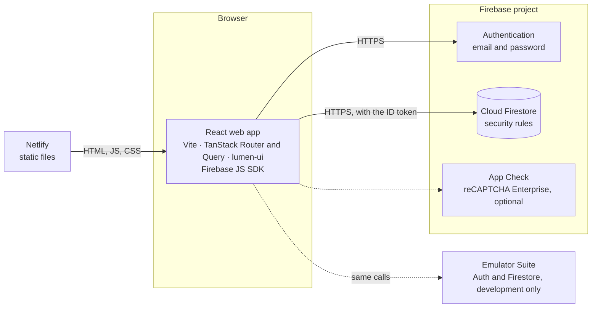

# Expensify — Functional Requirements & Technical Specification

Oct 10, 2026 · Sandip

## 1. Overview

Expensify is a personal tracker for income, expenses and transfers between your own accounts. The React web app in this repository talks straight from the browser to **Firebase**: Firebase Authentication (email and password) for logins and Cloud Firestore for the data, the way the sibling Angular app `expensify-web` does. There is no server of our own; Netlify hosts the built app as a static site.

This document does two jobs:

- It describes what the app does today: sections 2 to 6 and 11 to 13.
- It is the contract for the data: the business rules (section 4), the Firestore data model (section 8), the data-access contract and security rules (section 9) and the Firebase notes (section 10). Any change to the data changes sections 8 and 9 together with `firestore.rules` and the `*.api.ts` files, in the same change.

The dashboard answers three questions for one period at a time: where did my money go, am I within budget, and am I saving more than last month?

### Goals

| Goal | Measure | Target |
| --- | --- | --- |
| Fast entry | Time from opening the form to a saved entry | Under 5 s; Ctrl+Enter saves; "Save and add another" for runs of entries |
| Trustworthy numbers | App balances match real bank, card and cash balances | Any gap fixed in one reconcile step |
| Instant insight | "Spent vs budget this month" visible without digging | On the dashboard |
| Fast load | Dashboard ready on a mid-range phone over 4G | Under 2.5 s |
| Private data | Each user sees only their own records | Enforced by the Firestore security rules on every read and write |

### Scope

**In scope:** the responsive web app (phone, tablet and desktop browsers); the Firebase project behind it (Authentication, Cloud Firestore and its security rules); one currency (Nepali rupees) with Nepali number formatting.

**Out of scope for now:** native mobile apps, bank syncing, multi-currency, offline use, push notifications, receipts, CSV import and backups, shared wallets, Google sign-in and password reset by email. Section 16 lists the backlog.

### Users

| Persona | Main need | Features that serve it |
| --- | --- | --- |
| Salaried professional | Stay within a monthly budget; salary and rent arrive on a schedule | Budgets, recurring rules, dashboard |
| Freelancer | Track irregular income; keep business and personal money apart | Several accounts, income categories, cash flow report |
| Student | Make a small allowance last; mostly cash and a mobile wallet | Quick entry, cash and wallet accounts, daily reminder |

### Glossary

| Term | Meaning |
| --- | --- |
| Account | Where money sits: cash, bank, credit card, mobile wallet, savings, loan or other |
| Liability account | A credit card or loan. Its balance is stored negative while money is owed and shown as a positive "Owed" figure |
| Transaction (entry) | One money movement: income, expense or transfer |
| Transfer | Money moved between two of the user's own accounts; neither income nor expense |
| Category | What money was spent on or earned from; typed as expense or income |
| Budget | A spending limit per week, month or year, for all expenses or chosen categories |
| Recurring rule | A transaction template plus a schedule, such as salary, rent or a subscription |
| Occurrence | One date a recurring rule is due on; it is either added as an entry or skipped |
| Ask-first rule | A recurring rule that waits for the user to confirm or skip each occurrence |
| Period | A date range: a Monday-to-Sunday week, a calendar month, a calendar year or a custom range, both ends included |
| Reconcile | Setting an account's balance to what the bank or wallet really shows |
| Archive | Hide an account or category from pickers while keeping its history; it can be restored |
| Pause | Stop a budget or recurring rule without deleting it |
| Include in total | Whether an account counts toward the total balance |

## 2. What's in the app

Every module below is built in the web app and keeps its data in Firestore (sections 8 and 9).

| Module | What it covers | Main screens |
| --- | --- | --- |
| Authentication and profile | Sign up, log in with username or email, profile and photo, change password, delete account | `/login`, `/signup`, Settings |
| Dashboard | Period summary with change from the previous period, balances, spending by category, budgets, 6-period trend, recent and upcoming entries, privacy mode | `/` |
| Transactions | Add, edit, duplicate and delete income, expenses and transfers; make an entry recurring | Form sheet, `/transactions/:id` |
| Transaction list | Day-grouped history, period presets, filters, search, totals, Excel and PDF export | `/transactions` |
| Accounts | Seven account types with live balances, credit card usage, reconcile, archive, account page | `/accounts`, `/accounts/:id` |
| Categories | Expense and income categories with icons and colors, archive, default set | `/categories` |
| Budgets | Weekly, monthly or yearly limits, rollover, alerts, history by period | `/budgets`, `/budgets/:id` |
| Recurring | Schedules, automatic or ask-first entries, catch-up of missed dates, pause and resume | `/recurring`, `/recurring/:id` |
| Reports | Cash flow, spending by category, category trends, accounts and net worth, budget history; Excel and PDF export | `/reports/*` |
| Alerts and reminders | Budget alerts, recurring reminders, daily reminder, alert list behind the bell, system notifications | Header bell |
| Settings | Profile, password, theme, notification preferences, delete all transactions, delete account | `/settings` |

## 3. Functional requirements

Requirements are numbered per module (AUTH-01…) so tickets, tests and the code can point to them. Every requirement in this section is implemented in the web app; section 9 says which Firestore reads and writes carry each one.

### 3.1 Authentication and profile

| ID | Requirement |
| --- | --- |
| AUTH-01 | Sign up with a name (1–60 characters), a username, an email and a password of at least 8 characters. The password field shows a strength checklist as a hint; only the length is enforced, by the forms (Firebase itself asks for 6). |
| AUTH-02 | A username is 3–30 letters, numbers, dots, dashes or underscores, and not `__…__`, which Firestore keeps for itself. It is stored lowercase, so "Sita.R" and "sita.r" are one login, and it can never change. |
| AUTH-03 | An email is unique across users, ignoring case; Firebase Authentication enforces it. A taken username or email shows its message on that field (`AppError` code `taken` with `field`). Signup checks the username is free before it creates the login. |
| AUTH-04 | A new account is logged in at once and lands on the dashboard. No verification email is sent and there is no approval step. Signup creates the Firebase login, then writes the profile, the username and the default categories (appendix A) in one batch, with no accounts. If that batch fails, the login is deleted again so the same email can sign up once more. |
| AUTH-05 | Log in with the username or the email, both case-insensitive, and the password. A value with "@" is an email; anything else is a username, looked up in `usernames/{username}` to find its email (and a new email still waiting on its link, which is tried second). Wrong details show "Wrong username, email or password." |
| AUTH-06 | The session lasts until the user logs out. Firebase Authentication keeps it in the browser's IndexedDB, and every open tab shares it: logging out in one tab logs out the others. |
| AUTH-07 | A signed-out user who opens a protected page goes to `/login?redirect=<path>` and returns to that page after logging in or signing up. The redirect survives switching between the two pages. Only paths inside the app are followed: `//host`, `/\host` and absolute URLs go to the dashboard instead. Route guards wait for Firebase to restore the saved session first. |
| AUTH-08 | A logged-in user who opens `/login` or `/signup` goes to the dashboard. |
| AUTH-09 | When the session ends while a signed-in page is open (logged out in another tab, the login deleted, or its email or password changed elsewhere), the tab reloads on `/login`, which also clears every cached query. |
| AUTH-10 | Edit the full name (1–60) and email in Settings. A new email needs the current password; it gets a verification link, and the login switches only once the link is opened. Until then Settings shows "Waiting on the link we sent to {email}", and logging in with the username tries both emails. The profile and the username lookup take the new email the next time the profile loads. The username shows read-only with "You log in with it, so it can't be changed." (a login without a username, section 9.3, shows none). |
| AUTH-11 | Add, change or remove a profile photo. The device scales the picked image to a 128 px square JPEG and saves it on the profile at once; without a photo the avatar shows initials. |
| AUTH-12 | Change the password from Settings or the account menu: the current password (a wrong one shows "That password isn't right" on its field) and a new one of at least 8 characters, different from the current one. The current password re-authenticates the login before Firebase changes it. |
| AUTH-13 | Delete the account: the user types `DELETE` and enters their password, which re-authenticates the login. Every record they own, their username, their profile and their login are deleted, this browser's alert history is cleared, and the app lands on `/login?deleted=1` with "Your account and everything in it were deleted." |
| AUTH-14 | Log out from the account menu in the header. |

### 3.2 Dashboard

The dashboard is the first screen after logging in. Every figure follows the totals rules in section 4.

| ID | Requirement |
| --- | --- |
| DSH-01 | Switch the period: This month, Last month or Custom (From and To dates; reversed dates are swapped). The period label reads "September 2026" for a calendar month, otherwise the date range. The choice lives in the URL (`period`, `from`, `to`) and replaces the history entry. |
| DSH-02 | Show income, expense, net and savings rate for the period. Savings rate is net ÷ income as a whole percent, "—" with no income. |
| DSH-03 | Show each summary figure's change from the previous period: the amount and percent ("New" when there was nothing before), and savings rate in points. An arrow and a sign show the direction, never color alone. The change is hidden when the previous period has no income or expense. |
| DSH-04 | Income and Expense open the transaction list filtered to the period and type; Net and Savings rate open it filtered to the period. |
| DSH-05 | Show the total balance (non-archived accounts marked "include in total", with "Across N accounts · M not included") and each active account's balance; cards and loans read "Owed" or "In credit". The total opens Accounts and an account opens its page. |
| DSH-06 | Chart the period's expenses by category as a donut: the top 5 categories plus "Other" when two or more are left over, with the total and entry count in the middle and a list with amounts and shares. A "Table" toggle replaces the list with a table. A slice opens the transaction list filtered to that category ("Other" to all of its categories); uncategorized entries can't be opened. |
| DSH-07 | Show up to 5 active budgets, most used first, with spent of limit, a bar, a state chip, % used and what's safe to spend per day. A row opens the budget's page; "See all" shows when there are more than 5. |
| DSH-08 | Chart income vs expense for the selected period and the 5 before it, with each period's net and a "Table" toggle. The presets use calendar months; a custom range uses earlier ranges of the same length. Clicking a bar selects that period. |
| DSH-09 | List the 5 newest entries of the period. A row opens the entry; its menu offers Edit and Delete; "See all" opens the list for the period. |
| DSH-10 | List recurring occurrences due by today or within the next 7 days, with Confirm and Skip on due ask-first rules. The card is hidden when there are none. |
| DSH-11 | Privacy mode: an eye button masks every amount as "••••", including chart tooltips and axes. Percentages and chart shapes stay. It is remembered per browser, synced across open tabs, and applies to the dashboard only. |
| DSH-12 | Give each card an empty state with its next action. A period with no entries replaces the summary, spending, trend and recent cards with one "Nothing logged in {period}" card. |
| DSH-13 | Layout: one column on phones; two on tablets; on desktop the summary across the top, then balances, spending and budgets, then the trend beside recent entries, then upcoming. The period switcher sticks to the top while scrolling. |

### 3.3 Transactions

| ID | Requirement |
| --- | --- |
| TXN-01 | Add an expense, income or transfer with an amount above 0, an account, a date and an optional note of up to 500 characters (a blank note is saved as none). Expenses and income need a category of their type; transfers need a different "to" account and have no category. Entries have no payee, tags, time of day, receipts or splits. |
| TXN-02 | A new entry starts as an expense dated today, on the account this device used last while it's still active, otherwise the first active account. The date has Today and Yesterday shortcuts and accepts any date. |
| TXN-03 | Pickers show active categories and accounts, plus an archived one the entry already uses, marked "(archived)". The category grid shows 8 tiles when there are more than 9, with "Show all N categories". |
| TXN-04 | With no categories of the chosen type, the form offers "Add default categories". With no active accounts, the app asks for an account first and then opens the form on it. |
| TXN-05 | "Save and add another" keeps the type, account and date and clears the rest. Ctrl/⌘+Enter saves; Ctrl/⌘+Shift+Enter saves and adds another. |
| TXN-06 | Edit any field. The same Firestore transaction reverses the old entry's effect on balances and applies the new one, including when the type or accounts change. |
| TXN-07 | Delete after a confirmation that says what happens to the balance; there is no undo. |
| TXN-08 | Duplicate an entry into the add form, dated today. |
| TXN-09 | "Make recurring" opens the recurring rule form filled from the entry, repeating monthly from one period after its date. An entry added by a rule that still exists offers "Open recurring rule" instead and shows a "Recurring" chip. |
| TXN-10 | A future-dated entry changes balances at once and shows an "Upcoming" chip. |
| TXN-11 | The entry page (`/transactions/:id`) shows the amount, type, category and account (or from and to accounts), date, when it was added and last edited, and the note, with Edit, Duplicate, Make recurring and Delete. |
| TXN-12 | Entries whose account or category was deleted keep working and show "Deleted account" or "Deleted category". |

### 3.4 Transaction list, search and export

| ID | Requirement |
| --- | --- |
| LST-01 | Pick the period: This month (default), Last month, This year or Custom. Phones get a select, wider screens a segmented control. |
| LST-02 | Load the whole period in one query and filter it on the device by type, accounts (either side of a transfer, archived ones included), categories (of the chosen type; hidden for transfers) and an inclusive amount range (swapped if reversed). A badge counts the active filters and removable chips show them, with "Clear all". |
| LST-03 | Search the note, category name and account name. Every typed word must match, ignoring case. |
| LST-04 | Show income, expense and net totals for what's on screen; transfers don't count. |
| LST-05 | From 1,024 px wide, show a table grouped by day with each day's net: Date, Description, Category, Account, Amount and an actions column. Columns sort ascending, descending or not at all; day headers show only while unsorted. Narrower screens show day-grouped rows with a menu. |
| LST-06 | Accept drill-downs in the URL: `from`, `to`, `type`, `category` and `account` (one id, or several joined by commas). Invalid values are dropped, and the sidebar's plain link resets the page. Changes made on the page are not written back to the URL. |
| LST-07 | Export what's on screen, oldest first, to Excel or PDF (appendix B). With nothing to export, a message shows and no file is made. |
| LST-08 | Empty states: "No matches" with a button to clear search and filters, or "No transactions in {period}" with Add and "Show this month". |

### 3.5 Accounts

| ID | Requirement |
| --- | --- |
| ACC-01 | Create an account with a name (1–40), a type (cash, bank, credit card, mobile wallet, savings, loan, other; default cash), an opening balance that may be negative, and "include in total" (default on). Cards and loans enter the amount owed as a positive figure, stored negative. Credit cards take an optional credit limit above 0. |
| ACC-02 | Each account's icon and color come from its type (appendix A); there is no picker. Every account is in NPR; there is no currency choice. |
| ACC-03 | List the total balance (red when negative), the active accounts in creation order, and an "Archived (N)" section. |
| ACC-04 | Each account shows its balance; cards and loans show "Owed" or "In credit". A card with a limit shows a "Credit used" bar: accent under 80%, warning from 80%, error from 100%. Chips mark "Archived" and "Not in total". |
| ACC-05 | Edit any field, including the type. Changing the opening balance moves the current balance by the same difference. On a type change the icon and color follow the new type only while they are still the old type's defaults. |
| ACC-06 | Reconcile: the user enters the real balance (or amount owed); the form shows the in-app figure and the adjustment, and saving sets the current balance to it. No transaction is created, so reports and budgets don't see the adjustment. |
| ACC-07 | Archive an account: it leaves pickers, the dashboard and the total but keeps its history, and can be restored. A confirmation shows first when its balance isn't zero. Archived accounts can't be edited or reconciled until restored. |
| ACC-08 | Delete an account after a confirmation that suggests archiving instead. Deleting is allowed while entries use it; they keep it and show "Deleted account". |
| ACC-09 | The account page shows the current balance, opening balance and credit limit with % used, and every entry touching the account (either side of a transfer) grouped by day with each day's net, with an Add button set to the account. |

### 3.6 Categories

| ID | Requirement |
| --- | --- |
| CAT-01 | Keep separate expense and income lists, shown as tabs. |
| CAT-02 | Create a category with a type, a name (1–30, unique within its type ignoring case; archived categories count) and one of 48 built-in icons. A new category gets a random color from a 12-color palette, preferring colors its type doesn't use yet; there is no color picker. |
| CAT-03 | Rename a category and change its icon. Its type can't change after creation. |
| CAT-04 | Archive and restore: archived categories leave pickers, and entries that use them keep them. |
| CAT-05 | Delete after a confirmation that suggests archiving instead. Deleting is allowed while entries use it; they show "Deleted category", and budgets that counted it show "Deleted categories" until they're saved again. |
| CAT-06 | "Add default categories" adds the defaults in appendix A that the user doesn't have, matched by type and name, or says "Nothing to add". It is offered on the empty Categories page and in the transaction form. |
| CAT-07 | Categories list by `sortOrder`, then name; a new one goes to the end of its type. There is no reordering and no subcategories. |

### 3.7 Budgets

| ID | Requirement |
| --- | --- |
| BUD-01 | Create a budget with a period (weekly, monthly or yearly; default monthly), a limit above 0, expense categories (none means every expense), a name (1–40) that follows the chosen categories until typed ("All expenses", "Food", "Food & Transport", "Food & 2 more"), "Roll over what's left" (default off) and "Alert me at 80% and 100%" (default on). |
| BUD-02 | Show spent of limit, % used (rounded down), state (on track, warning, over), what's left or over, days left, and what's safe to spend per day (section 4). |
| BUD-03 | Rollover adds last period's unspent amount to this period's limit, or takes an overspend off it, never below 0 (BR-10). |
| BUD-04 | List active budgets ("All expenses" ones first, then by name) and a "Paused (N)" section. |
| BUD-05 | The budget page shows the current period and its past results: 8 weeks, 6 months or 2 years. Periods before the budget was created are marked. Selecting a period lists the expenses it counted, 50 at a time. |
| BUD-06 | Pause and resume without a confirmation: a paused budget keeps its settings but shows no progress and sends no alerts. Delete after a confirmation; transactions are untouched. |
| BUD-07 | Alert once per threshold per period (NTF-01). |

### 3.8 Recurring transactions

| ID | Requirement |
| --- | --- |
| REC-01 | Create a rule from scratch or from a transaction ("Make recurring"). A rule holds a template (type, amount, account or from and to accounts, category, note), a schedule, an end and a mode. |
| REC-02 | Schedules repeat daily, weekly on chosen weekdays, monthly on day 1–31 or the last day, or yearly, every N periods (1–99), from a start date (BR-12). |
| REC-03 | A rule ends never, after N entries (1–999), or on a date on or after the start. |
| REC-04 | On the due date the rule either adds the entry automatically (default) or asks first. |
| REC-05 | The form previews the next 3 dates. A new rule with a past start date says how many entries up to today it will add, or leave waiting. |
| REC-06 | Automatic rules add every due date up to today, oldest first, in writes of at most 100, including dates missed while the app was closed. Each date is added exactly once, even with several tabs open (BR-13). |
| REC-07 | Ask-first occurrences wait under "Waiting for you" on the Recurring page and on the dashboard: Confirm adds the entry, Skip passes over it, and Edit adds it as edited (its date may change). Each acts on the oldest due date. The sidebar's Recurring item shows how many are waiting. |
| REC-08 | Edits apply to future entries only. The next due date is recomputed only when the schedule changes, counting from the earlier of the old next due date and today, so a waiting entry isn't lost. |
| REC-09 | Pause and resume. Resuming skips dates that passed while paused. An ended rule can't be paused; editing its end runs it again. |
| REC-10 | Delete after a confirmation; entries already added stay. |
| REC-11 | A rule is active, paused, ended, or blocked because an account it uses was deleted; a blocked rule adds nothing and asks to be edited. |
| REC-12 | The rule page shows the amount, schedule, details, the next 5 dates and the entries it added, 50 at a time. |

### 3.9 Reports

| ID | Requirement |
| --- | --- |
| RPT-01 | A Reports page lists five reports as cards, each with "Excel · PDF" and "Open report". |
| RPT-02 | Every report keeps its filters in the URL, offers Reset, states what it shows in one line, exports to Excel and PDF (appendix B), and drills down to the transaction list where a figure stands for entries. |
| RPT-03 | Period presets for the first four reports: this month, last month, last 3, 6 or 12 months (including the current one), this year, last year, custom. |
| RPT-04 | **Cash flow** (`/reports/cash-flow`): income, expense, net and savings rate by week, month or year for chosen accounts (default last 12 months by month), with tiles, a chart and a table with a running net and totals. |
| RPT-05 | **Spending by category** (`/reports/categories`): expense or income per category against the previous period (BR-06), with tiles, a donut of the top 6 plus Other, the 5 biggest changes and a table of every category. |
| RPT-06 | **Category trends** (`/reports/category-trends`): a category-by-month table (at most the last 24 months) with shaded cells, filtered by type, accounts and categories; a cell opens that month's entries. |
| RPT-07 | **Accounts and net worth** (`/reports/accounts`): an account statement (opening, income, expense, transfers in and out, closing, change) and assets, liabilities and net worth at the end of each week, month or year. Balances are worked back from the current balance (BR-17). Without a chosen account it covers the accounts in the total. |
| RPT-08 | **Budget history** (`/reports/budgets`): every budget's hit rate, periods over and overspend, or one budget's periods with limit, carry, spent, remaining and state, looking back 6, 12 or 24 periods, optionally with paused budgets and periods before a budget started. |
| RPT-09 | Reports follow the totals rules (section 4): transfers are left out of income, expense and category figures, but count as money in and out on account statements. |

### 3.10 Alerts and reminders

| ID | Requirement |
| --- | --- |
| NTF-01 | Budget alerts: when a budget reaches 80% or 100% of its limit, alert once per threshold per period, and only the higher one if both are crossed at once. The threshold is recorded on the budget in Firestore (`lastAlert`) as the alert shows, so other tabs and reloads don't repeat it. Paused budgets and budgets with alerts off never alert. |
| NTF-02 | Daily reminder (opt-in): at a chosen half-hour, if nothing but recurring entries is dated today, remind the user to log their spending. If the app opens after that time, it reminds then. At most once a day. |
| NTF-03 | Recurring reminders for ask-first rules: the day before a date, and when entries are waiting (one reminder for a catch-up of several). Each is shown once. |
| NTF-04 | Turn each kind on or off in Settings, and pick the reminder time. |
| NTF-05 | Deliver alerts as an 8-second toast while the tab is visible, or as a system notification while it's hidden if the user allowed notifications. Clicking either opens the alert's page. |
| NTF-06 | Keep alerts in a list behind the header's bell: an unread badge, newest first, at most 50 for at most 30 days, per browser and shared by open tabs. Opening the list marks everything read; an alert can be removed, or all cleared. |
| NTF-07 | All of this runs only while the app is open in a browser. Alert history and reminder state stay on the device and aren't synced. They belong to the user who last logged in on that browser, and start over when a different user logs in. |

### 3.11 Settings

| ID | Requirement |
| --- | --- |
| SET-01 | Settings has four sections: Profile, Appearance, Notifications, and Data and privacy. |
| SET-02 | Theme: light, dark or system. It changes at once, is saved on the profile, goes back if the save fails, and is also kept in the browser so the first paint and the login page use it. |
| SET-03 | Notifications: the three switches of NTF-04, the reminder time, and the browser permission state with an "Allow notifications" button. |
| SET-04 | Delete all transactions after a confirmation that shows the count. Each account's balance goes back to where it was without them; accounts, categories, budgets and recurring rules stay. |
| SET-05 | Delete the account (AUTH-13). |

### 3.12 App shell

| ID | Requirement |
| --- | --- |
| APP-01 | The sidebar lists Dashboard, Transactions, Accounts, Budgets, Reports, Recurring, Categories and Settings. On desktop it collapses to icons; at 768 px and below it becomes a drawer. |
| APP-02 | The header holds the sidebar toggle, the alerts bell and the account menu (avatar, name, email, Change password, Logout). |
| APP-03 | Forms open as sheets: a bottom drawer on phones (under 600 px), a centered dialog on wider screens. Confirmations are always a dialog. |
| APP-04 | Pages sit in one centered column up to 1,200 px wide. Only the content pane scrolls, and Back restores its position. |

## 4. Business rules

Every balance change comes from one effect table, and every total follows the same rules, so the dashboard, budgets and reports always agree. The web app computes totals, and its data-access code (section 9) writes entries and moves balances in Firestore. Both must follow these rules exactly.

### Balance effects

| Type | Source account | Destination account | Counts toward |
| --- | --- | --- | --- |
| Income | + amount | — | Income totals and income categories |
| Expense | − amount | — | Expense totals, expense categories and budgets |
| Transfer | − amount | + amount | Nothing; it only moves money |

An account's current balance = its opening balance + the effects of all its entries + any reconcile adjustments. Creating an entry applies its effects; deleting one reverses them; editing one reverses the old effects and applies the new ones. Each of these happens in one Firestore transaction with the entry write, with `increment()` on each balance. For example, changing a Rs 30 Cash expense to Rs 45 from Bank moves Cash +30 and Bank −45 together.

### Rules

| ID | Rule |
| --- | --- |
| BR-01 | Amounts are in the account's currency with at most 2 decimal places, stored as plain Firestore numbers, never strings. The app sums in thousandths so 0.1 + 0.2 stays 0.3. |
| BR-02 | `amount` is always positive; `type` gives the direction. |
| BR-03 | One currency: every account is NPR. Amounts show the Nepali way with the `en-IN` locale: "Rs 12,34,567.50", compact "Rs 1.2L" on chart axes. |
| BR-04 | Net = income − expense. Savings rate = net ÷ income × 100, a whole percent; "—" when income is 0. Transfers are never income or expense. |
| BR-05 | Dates are the user's local calendar date written `YYYY-MM-DD`. They are stored as those strings and never converted, so an entry never moves to another day. The device decides what "today" is. |
| BR-06 | Weeks run Monday to Sunday; months and years follow the calendar; custom ranges include both ends. "Last N months" includes the current month. A period's previous period is the year, month or run of whole months before it, otherwise the same number of days before it. |
| BR-07 | A budget's spent = the sum of expenses in its categories (or all expenses) dated within the period. Income and transfers never count. |
| BR-08 | Budget state from % used: under 80 is on track, 80–99 is warning, 100 or more is over. Thresholds are compared without rounding (spent × 100 ≥ threshold × limit) and % used shows rounded down, so 79.6% reads 79%, on track. A zero limit shows "—" and is over. |
| BR-09 | Safe to spend per day = remaining ÷ days left in the period (today included), rounded down to the paisa; 0 when nothing is left. |
| BR-10 | Rollover: this period's limit = amount + (amount − the previous period's spent), never below 0. It reaches back one period only and takes nothing from a period that ended before the budget was created. |
| BR-11 | Budget alerts: each threshold alerts once per period. `lastAlert` holds the highest threshold alerted in the period starting on `periodStart` and is never lowered for the same period. |
| BR-12 | Recurring schedules: the first entry falls on the first schedule date on or after the start date. Daily rules count every N days from the start date. Weekly rules use the chosen ISO weekdays (1 = Monday … 7 = Sunday; none means the start date's weekday), every N weeks counted in Monday-to-Sunday weeks from the start week. Monthly rules use day 1–31, every N months from the start month, and days 29–31 fall on the last day of shorter months. Yearly rules repeat the start date's day and month, and 29 February falls on the 28th in common years. |
| BR-13 | Recurring occurrences are handled oldest first, starting at `nextDueDate`. Each date is handled exactly once, either added or skipped; skipped dates don't count toward an "after N entries" end. Handling moves `nextDueDate` to the next schedule date. A rule ends when its count is reached or its next date is after its end date. |
| BR-14 | Percentages show as whole numbers rounded half up, except budget % used (BR-08). A change from nothing reads "New". |
| BR-15 | Text limits: account name 1–40, category name 1–30, budget name 1–40, note up to 500, user name 1–60. Names are trimmed. |
| BR-16 | Credit cards and loans are liabilities: what is owed is stored as a negative balance and shown as a positive "Owed". Credit used = owed ÷ credit limit. |
| BR-17 | An account's balance at the end of day D = its current balance − the effects of every entry dated after D, future-dated ones included. Net worth = assets (balances above 0) − liabilities (balances below 0, as positive amounts). |
| BR-18 | Future-dated entries change balances when they are saved and show as "Upcoming". |

## 5. User stories and acceptance criteria

Each acceptance criterion should become one end-to-end test against the Firebase emulators (section 14).

| ID | Story | Acceptance criteria |
| --- | --- | --- |
| US-01 | As a user, I log an expense in a few taps so I don't skip logging. | From any page, Add transaction opens the form with Expense, today and my last account. After an amount, a category and Save, the entry tops today's list and the account balance drops by the amount. |
| US-02 | I move money between my accounts. | With Bank at Rs 1,000 and Cash at Rs 50, a Rs 200 transfer from Bank to Cash leaves Bank at Rs 800 and Cash at Rs 250. This month's income and expense don't change. |
| US-03 | I fix a wrong entry. | Changing a Rs 30 Cash expense to Rs 45 from Bank leaves Cash Rs 30 higher and Bank Rs 45 lower than before the edit. |
| US-04 | I'm warned before I overspend. | A monthly Food budget of Rs 500 has Rs 380 spent. A Rs 50 Food expense shows the warning state (86%) and one 80% alert; later Food expenses that month raise no second 80% alert, and crossing Rs 500 raises one 100% alert. |
| US-05 | My salary logs itself. | A monthly automatic rule "Salary Rs 50,000 on day 1" adds exactly one income dated the 1st when the app is open that day, even in two tabs. If the app isn't opened until the 3rd, the entry is added then, still dated the 1st. |
| US-06 | Rent waits for me. | An ask-first rent rule due today shows under "Waiting for you" and on the dashboard, and the sidebar badge reads 1. Confirm adds one entry; Skip adds none; either clears the badge. |
| US-07 | My balance matches the bank. | Bank reads Rs 12,000 in the app; reconciling to Rs 11,500 sets it to Rs 11,500 and changes no report or budget figure. |
| US-08 | I start the moment I sign up. | A new sign-up lands on the dashboard with no approval step, sees none of another user's data, and finds the default categories ready. |
| US-09 | I delete my account. | After typing DELETE and my password, my records and login are gone and I'm on `/login?deleted=1`. Logging in with the old details fails. |
| US-10 | My data is mine. | User A can't read, change or delete user B's records: the security rules refuse every read or write under `users/{B's uid}` with `permission-denied`, and nobody can list the usernames. |

## 6. Non-functional requirements

| ID | Area | Requirement |
| --- | --- | --- |
| NFR-01 | Performance | Dashboard ready in under 2.5 s on a mid-range phone over 4G; route changes under 300 ms. |
| NFR-02 | Performance | A period's entries load in one Firestore query in under 300 ms at the 95th percentile for a user with a year of entries (about 5,000). Each query uses one filter (a date range, an account or a recurring rule), so Firestore's automatic single-field indexes serve it, and its time depends on how many entries come back, not on how many the user has. |
| NFR-03 | Performance | Routes are code-split. The Firestore SDK and the data code load with the first data query, so the login page starts with only the Firebase app and Auth; the PDF library loads on the first PDF export. |
| NFR-04 | Scalability | 50,000 transactions per user and any number of users without a data model change; every query reads one user's subcollection and is served by an index. |
| NFR-05 | Responsive | Usable from 320 px to 1,920 px wide, with breakpoints at 600 px (phone), 768 px (sidebar drawer) and 1,024 px (desktop table and dashboard grid). |
| NFR-06 | Accessibility | WCAG 2.2 AA: keyboard access, visible focus, labels, 4.5:1 text contrast. Income and expense never rely on color alone; each also has a sign and an icon. Dashboard charts have a table view; report charts sit beside tables of the same figures. |
| NFR-07 | Security | HTTPS only: Netlify serves the app and Firebase serves Auth and Firestore over HTTPS. Firebase Authentication holds the passwords; the app never stores them. Every Firestore read and write passes the security rules in `firestore.rules` (section 9.2): a user reaches only `users/{their uid}` and the username lookup, and every write is checked field by field. Firebase throttles repeated failed logins (`auth/too-many-requests`). App Check with reCAPTCHA Enterprise, when its site key is set, makes Firebase refuse requests that don't come from the site. The Firebase web config is public by design; no secret is in the repository or the bundle. |
| NFR-08 | Privacy | No amounts, notes or names in logs or analytics. Deleting an account removes every record the user owns, their username and their login. One accepted exception: anyone who knows a username can read its login's email from the public lookup (section 16). |
| NFR-09 | Integrity | An entry write and its balance changes commit together: in one Firestore transaction for a single entry or a run of recurring entries, and in one batch per chunk when deleting every entry. Balances move with `increment()`, so two tabs writing at once both count. There is no server-side recompute now: nothing checks balances against entries after the fact. |
| NFR-10 | Compatibility | The last 2 versions of Chrome, Edge, Firefox, Safari (macOS and iOS) and Samsung Internet. |
| NFR-11 | Localization | English UI. Money always in the `en-IN` format; dates in the browser's language. |
| NFR-12 | Maintainability | Strict TypeScript and ESLint. Domain rules (section 4) covered by unit tests, and the security rules by tests against the Firestore emulator. `firestore.rules`, the `*.types.ts` files and the `*.api.ts` writes change together. |
| NFR-13 | Observability | Error reporting (such as Sentry) in the web app. Firestore usage and security-rule denials watched in the Firebase console. |

## 7. Architecture

The web app is a single-page React app. It talks to Firebase straight from the browser through the Firebase JS SDK: Firebase Authentication for logins and Cloud Firestore for the data. Netlify serves the built app as static files. During development the same code talks to the Firebase Emulator Suite instead; one setting, `VITE_FIREBASE_USE_EMULATORS`, switches between them.



The work splits like this:

- **The app** decides what "today" is, works out periods, recurring dates and alerts, and computes every total and chart from lists of entries. Its data-access code (section 9) checks each write, moves account balances in the same Firestore transaction or batch as the entry, and makes sure each recurring date is handled once.
- **Firebase** signs people in and stores the data. The security rules keep each user's data apart and refuse any write whose fields have the wrong shape. They don't look at other documents, except the profile a new username is claimed with.

### Key decisions

| Decision | Choice | Why |
| --- | --- | --- |
| Backend | Firebase: Authentication and Cloud Firestore, called from the browser | No server of our own to run or patch; the same setup as the sibling app `expensify-web` |
| Data isolation | Everything a user owns lives under `users/{uid}`, and the rules let only that uid in | One rule on the path keeps users apart; no query can forget a filter |
| Data access | The Firebase JS SDK, called only from each feature's `*.api.ts` and the auth session | Components and query hooks never import Firebase |
| Authentication | Firebase Auth email and password; usernames log in through a public `usernames/{username}` lookup | Firebase Auth has no usernames, and the lookup must be readable before anyone is logged in |
| Money | Plain numbers with at most 2 decimals | Firestore has no decimal type; the app sums in thousandths |
| Dates | `YYYY-MM-DD` strings | No time zone shifts; the strings sort and filter by range like dates |
| Balances | Stored on the account and moved with `increment()` in the same transaction or batch as the entry | Cheap reads; there is no server to recompute them |
| Totals and charts | Computed in the browser from a period's entries | One query per period serves every figure; Firestore aggregation queries can come later if reports slow down |
| Recurring entries | Added by the app in a Firestore transaction that re-reads the rule and refuses a stale date | Each date once across tabs, without Cloud Functions |
| Deleting used accounts and categories | The document is deleted; entries keep its id | Firestore has no foreign keys; the app shows "Deleted account" or "Deleted category" |
| IDs | Firestore auto IDs (20-character strings) | Made on the device before the write, so one batch can write a document and refer to it |
| Indexes | Single-field indexes only; `firestore.indexes.json` is empty | Each query uses one filter and the app sorts (section 9.7) |
| Web UI | React 19, lumen-ui, TanStack Router and Query | Section 11 |
| Web hosting | Netlify, built from `main`, with a deploy preview per pull request | A static single-page app needs no server |

## 8. Firestore data model

Each user's data sits under their profile document, `users/{uid}`, where `uid` is their Firebase Auth uid. The only other top-level collection is the public username lookup. Field names are camelCase and match the app's types (`*.types.ts`), so a document reads straight into its type.

```
users/{uid}                        profile
├── accounts/{accountId}
├── categories/{categoryId}
├── transactions/{transactionId}
├── budgets/{budgetId}
└── recurringRules/{ruleId}
usernames/{username}               public lookup: username → uid and email
```

Across the collections:

- **IDs** are Firestore auto IDs: 20-character strings of letters and digits, made on the device before the write. The id is the document's name, not a field.
- **References** between documents are ids in fields (`accountId`, `toAccountId`, `categoryId`, `categoryIds`, `recurringRuleId`). Firestore has no foreign keys: deleting an account, category or rule leaves its id in place, and the app shows "Deleted account" or "Deleted category".
- **Money** is a number with at most 2 decimals. **Dates** are `YYYY-MM-DD` strings.
- **Timestamps:** every document except the username lookup has `createdAt` and `updatedAt`, set with `serverTimestamp()`: both on create, `updatedAt` again on every update. The app reads them as ISO strings (section 9.1).
- **No missing fields:** every field is written, `null` when it doesn't apply, and the rules refuse fields they don't list.

In the tables, plain notes are what `firestore.rules` checks on every create and update. Notes marked **App** are checked only by the app before it writes.

### users/{uid}

| Field | Type | Notes |
| --- | --- | --- |
| name | string | 1–60 characters, trimmed |
| username | string or null | `[a-z0-9._-]{3,30}`; can't change on update. Null only for a login whose signup batch never landed (section 9.3) |
| email | string | 3–254 characters; the login's email |
| pendingEmail | string or null | Up to 254 characters; a new email waiting on its verification link |
| photoUrl | string or null | `data:image/(jpeg\|png\|webp);base64,…`, at most 200,000 characters |
| preferences | map | `theme` and `notifications`, nothing else |
| preferences.theme | string | light · dark · system; default system |
| preferences.notifications.dailyReminder | boolean | Default false (opt-in) |
| preferences.notifications.reminderTime | string | `HH:mm`, 24-hour; default `20:00` |
| preferences.notifications.budgetAlerts | boolean | Default true |
| preferences.notifications.billReminders | boolean | Default true |
| createdAt, updatedAt | timestamp | |

### accounts

| Field | Type | Notes |
| --- | --- | --- |
| name | string | 1–40 characters, trimmed |
| type | string | cash · bank · credit_card · wallet · savings · loan · other |
| currency | string | Three capital letters; `NPR` today |
| openingBalance | number | May be negative |
| currentBalance | number | Any number. Starts at the opening balance; only the writes in section 9 move it (section 4) |
| creditLimit | number or null | Above 0. **App:** kept for credit cards only, null otherwise |
| icon | string | 1–40 characters; a lumen-ui icon name (appendix A) |
| color | string | `#RRGGBB` |
| includeInTotal | boolean | |
| archived | boolean | Starts false |
| sortOrder | number | **App:** one more than the highest, so accounts list in creation order |
| createdAt, updatedAt | timestamp | |

### categories

| Field | Type | Notes |
| --- | --- | --- |
| name | string | 1–30 characters, trimmed. **App:** unique within its type ignoring case; archived categories count |
| type | string | expense · income; can't change on update |
| icon | string | 1–40 characters; a lumen-ui icon name |
| color | string | `#RRGGBB` |
| archived | boolean | Starts false |
| sortOrder | number | **App:** position within its type; a new one goes after the last |
| createdAt, updatedAt | timestamp | |

### transactions

| Field | Type | Notes |
| --- | --- | --- |
| type | string | expense · income · transfer |
| amount | number | Above 0, at most 1,000,000,000,000 |
| currency | string | Three capital letters; the source account's |
| accountId | string | The source account's id |
| toAccountId | string or null | A transfer has one, different from `accountId`; income and expense have null |
| categoryId | string or null | Income and expense have one; a transfer has null. **App:** a category of the entry's type |
| date | string | `YYYY-MM-DD`, the user's local date. **App:** a real calendar date |
| note | string or null | Up to 500 characters, trimmed; an empty note is saved as null |
| recurringRuleId | string or null | The rule that added it; null for entries added by hand |
| accountIds | array of strings | `[accountId]`, or `[accountId, toAccountId]` for a transfer, so one query finds both sides of a transfer. The app drops it when it reads an entry |
| createdAt, updatedAt | timestamp | |

### budgets

| Field | Type | Notes |
| --- | --- | --- |
| name | string | 1–40 characters, trimmed |
| amount | number | The limit per period; above 0, at most 1,000,000,000,000 |
| period | string | weekly · monthly · yearly |
| categoryIds | array of strings | At most 100. **App:** expense category ids without duplicates; empty means every expense |
| rollover | boolean | BR-10 |
| alertThresholds | array of whole numbers | At most 10. **App:** sorted, without duplicates; `[80, 100]` with alerts on, `[]` with them off |
| lastAlert | map or null | `{ periodStart, threshold }`: a `YYYY-MM-DD` date and a whole number (BR-11). Starts null |
| active | boolean | False while paused; starts true |
| createdAt, updatedAt | timestamp | |

### recurringRules

| Field | Type | Notes |
| --- | --- | --- |
| template | map | `type`, `amount`, `accountId`, `toAccountId`, `categoryId` and `note`, under the same rules as a transaction's fields; no date |
| frequency | string | daily · weekly · monthly · yearly |
| interval | whole number | 1–99 |
| weekdays | array of whole numbers | At most 7. **App:** weekly rules only, ISO 1–7, sorted, without duplicates; empty otherwise |
| dayOfMonth | whole number or null | 1–31. **App:** monthly rules only |
| startDate | string | `YYYY-MM-DD` |
| endType | string | never · count · until |
| endDate | string or null | `YYYY-MM-DD`. **App:** `until` rules only, on or after `startDate` |
| maxCount | whole number or null | 1–999. **App:** `count` rules only |
| mode | string | auto · confirm |
| nextDueDate | string | `YYYY-MM-DD`; the next schedule date not yet added or skipped. **App:** works it out from the schedule |
| occurrences | whole number | 0 or more; entries added so far. Starts at 0 |
| active | boolean | False while paused; starts true |
| createdAt, updatedAt | timestamp | |

### usernames/{username}

The document id is the username, lowercase. It is the only data anyone can read without logging in, one document at a time by its name; nobody can list the collection. It has no timestamps.

| Field | Type | Notes |
| --- | --- | --- |
| uid | string | The login's uid; must be the writer's |
| email | string | The login's email; must equal the email in the writer's ID token |
| pendingEmail | string or null | Up to 254 characters; a new email waiting on its link, which a username login tries second |

## 9. Data-access contract

This is how the web app reads and writes Firestore. Each feature's `*.api.ts` is the only code that does, together with `src/features/auth/auth.session.ts` for the session; components and query hooks call those functions and never import Firebase. Any change to what is stored or how it's written updates this section and section 8, together with `firestore.rules` and the `*.types.ts` files, in the same change. The code is the reference when a detail isn't written here.

### 9.1 Conventions

| Topic | Rule |
| --- | --- |
| Paths | `users/{uid}/{collection}/{id}`, where `uid` is always the logged-in user's (`currentUid()` in `src/lib/firestore.ts`). Nothing the app sends can name another user. |
| IDs | Firestore auto IDs, as strings, in documents, URLs and the app's types. A new document's id is made on the device before the write. |
| Money | Numbers with at most 2 decimals: `1234.5`, never `"1234.50"`. |
| Dates | `YYYY-MM-DD` strings. The rules check the shape; the app's forms make sure it's a real date. |
| Timestamps | `serverTimestamp()` for `createdAt` on create and for `updatedAt` on every write. `toEntity()` reads them back as fixed-width UTC ISO strings such as `2026-10-10T07:10:33.375Z`, which the app compares as text; a write the server hasn't stamped yet reads as now. |
| Fields | Fields that don't apply are `null`. A field left `undefined` is dropped from the write rather than failing it (`ignoreUndefinedProperties`). |
| Lists | A read returns every matching document; there is no pagination. The app sorts. |
| Atomic writes | A **transaction** (`runTransaction`) when a write depends on what's stored: entries and their balances, opening-balance edits, recurring occurrences and skips, budget alerts. A **batch** (`writeBatch`) for writes known up front: signup, default categories, email changes, delete all, delete account. Firestore caps a commit at 500 writes, so bulk deletes go in batches of up to 450 (`MAX_BATCH_WRITES`). |
| Errors | The data code throws an `AppError` with a code where the screen does something other than show the message (table below). Everything else is a `FirebaseError`, which `getErrorMessage()` in `src/lib/errors.ts` turns into a sentence. There are no HTTP status codes. |
| Ownership | The rules refuse another user's documents with `permission-denied`. A missing document of the user's own is `AppError` `not-found`. |

| `AppError` code | Thrown when | What the screen does |
| --- | --- | --- |
| `wrong-password` | Wrong details at login; a wrong current password when changing the email or password or deleting the account | Login shows "Wrong username, email or password."; the others show "That password isn't right" on the password field |
| `taken` | A username or email taken at signup, an email taken on change, a category name its type already has. `field` names the form field: `username`, `email` or `name` | Signup and Settings show the message on that field |
| `stale` | A recurring date was already added or skipped, or the rule is paused: "Already handled, perhaps in another tab" | The runner ignores it; the rules are refetched to show where the other tab left them |
| `not-found` | A document that isn't there: an entry, account, category, budget or rule; or an account or category an entry needs was deleted | Shows the message |
| `signed-out` | A read or write with nobody logged in: "You're logged out. Log in again." | Shows the message; the session watch sends the tab to `/login` |

`getErrorMessage()` has a sentence for each Firebase code people can run into: wrong credentials, a taken email, a weak password, too many attempts (`auth/too-many-requests`), no connection (`auth/network-request-failed`, `unavailable`), a recent login needed (`auth/requires-recent-login`), a write the rules refused (`permission-denied`), the database over its quota (`resource-exhausted`), a clash with another write (`aborted`) and a deleted document (`not-found`). Firebase's own messages never reach the screen; an unknown code shows the caller's fallback.

### 9.2 Security rules

`firestore.rules` is the only check that runs outside the browser.

| Path | Read | Create | Update | Delete |
| --- | --- | --- | --- | --- |
| `users/{uid}` | That user | That user; a valid profile | That user; a valid profile with the same `username` | That user, once the profile's username lookup is gone or goes in the same batch (`existsAfter`) |
| `users/{uid}/accounts/{id}` | That user | That user; a valid account | That user; a valid account | That user |
| `users/{uid}/categories/{id}` | That user | That user; a valid category | That user; a valid category with the same `type` | That user |
| `users/{uid}/transactions/{id}` | That user | That user; a valid transaction | That user; a valid transaction | That user |
| `users/{uid}/budgets/{id}` | That user | That user; a valid budget | That user; a valid budget | That user |
| `users/{uid}/recurringRules/{id}` | That user | That user; a valid rule | That user; a valid rule | That user |
| `usernames/{username}` | Anyone, one document by name; nobody can list | Logged in; the id is a valid username; `uid` is the writer's and `email` the token's; the profile as it stands after the same batch holds this username (`getAfter`) | Its owner; `uid` and `email` still the writer's | Its owner |

"Valid" means the document has only the fields section 8 lists, each with the type, length, pattern or value given there, and `createdAt` and `updatedAt` are timestamps. For a transaction it also means the shape is right: a transfer has a `toAccountId` different from `accountId` and no category; income and expense have a category and no `toAccountId`; and `accountIds` matches the accounts. A recurring rule's template has the same shape.

So a username can only be claimed in the same batch as a profile that holds it, a profile's username can't change, and a profile can't be deleted while its username's lookup stays. A login therefore holds one username at a time: to re-create its profile under another username, it must give the first one up. Anyone who knows a username can read its login's email; that trade-off is accepted (section 16).

The rules don't look at other documents, so these are the app's job (sections 9.3 to 9.9):

- that an id in a field points at an existing document of the user's, and a `categoryId` at a category of the entry's type;
- that a category name is unique in its type;
- balances: `currentBalance` can be any number, and nothing ties it to the entries;
- that a date is a real calendar date, that `endDate` is on or after `startDate`, and that the fields a rule's frequency and end don't use are cleared;
- the values in `alertThresholds`, and that only credit cards have a `creditLimit`.

Someone who goes around the app can only spoil their own data, never anyone else's.

### 9.3 Auth and profile

**Sign up** (`register`)

1. The username is trimmed and lowercased. One that breaks AUTH-02 is `taken` "That username can't be used. Try another one."; one whose `usernames/{username}` exists is `taken` (field `username`) "That username is taken. Try another one."
2. `createUserWithEmailAndPassword` makes the login. `auth/email-already-in-use` is `taken` (field `email`) "There's already an account with this email. Log in instead."
3. The login's display name is set to the name. Then one batch writes the profile (`pendingEmail` and `photoUrl` null, default preferences), `usernames/{username}` as `{ uid, email, pendingEmail: null }`, and the 25 default categories (appendix A, each type's `sortOrder` counting from 0). No accounts.
4. If step 3 fails, the login is deleted again. When the rules refused the batch because someone claimed the username a moment before, the error is `taken` (field `username`).

**Log in** (`login`): the value is trimmed and lowercased. With "@" it is the email; otherwise `usernames/{value}` gives the email, then the pending email. Each is tried with `signInWithEmailAndPassword`; when none works, the error is `wrong-password` "Wrong username, email or password." Other errors, such as `auth/too-many-requests`, pass through.

**Load the profile** (`getProfile`): reloads the login, to pick up an email changed through its link (offline, the cached login will do), then reads `users/{uid}`. Preferences it lacks read as their defaults.

- **No profile:** the login's signup batch never landed and the login couldn't be deleted either. One batch writes a profile without a username (the name from the login's display name or email) and, when the user has no categories, the defaults (`createMissingProfile`). That login logs in with its email.
- **A different email on the login:** the verification link was opened. After refreshing the ID token (the rules compare the lookup's email with it), one batch sets `email` and clears `pendingEmail` on the profile and on the username lookup.

**Name and photo** (`updateProfile`): updates `name`, `photoUrl` or both on the profile; the login's display name follows the name.

**Preferences** (`updatePreferences`): updates only the fields sent, by path (`preferences.theme`, `preferences.notifications.dailyReminder`, …), so the rest stay as they are.

**Change email** (`changeEmail`): re-authenticates with the password (`wrong-password` "That password isn't right"). The current email again cancels a pending change and clears `pendingEmail`. Otherwise `verifyBeforeUpdateEmail` sends the link (`auth/email-already-in-use` is `taken`, field `email`, "That email belongs to another account."), and one batch sets `pendingEmail` on the profile and the username lookup. Firebase switches the login when the link is opened; the profile follows on its next load.

**Change password** (`changePassword`): re-authenticates with the current password (`wrong-password`), then `updatePassword`. This tab stays logged in.

**Delete account** (`deleteAccount`): re-authenticates (`wrong-password`). Reads the five subcollections and deletes every document in batches of up to 450, in the order transactions, recurring rules, budgets, accounts, categories. Then one batch deletes the username lookup and the profile, and last the Firebase login is deleted. It isn't one atomic write: if it stops partway, the user is still logged in with what's left, and deleting again finishes the job.

**Session** (`auth.session.ts`): route guards await `auth.authStateReady()` before they decide. `logout` signs out and does a full page load of `/login`, which drops every cached query. The signed-in layout's `watchSession` listens to `onAuthStateChanged` and loads `/login` when the session ends without the app leaving on purpose (AUTH-09). On entering the signed-in layout, `claimNotifications(uid)` starts this browser's alerts and reminder state over when they belonged to another uid.

### 9.4 Accounts

| Operation | Reads and writes |
| --- | --- |
| List | Every document in `accounts`, archived ones too, sorted by `sortOrder` in the app |
| Get | One document; a missing one is `not-found` "Account not found" |
| Create | Reads the list for the next `sortOrder`, then sets the form's fields with `currentBalance` equal to `openingBalance`, `archived` false and `creditLimit` null unless it's a credit card |
| Edit | A transaction: reads the account (missing is `not-found`), writes the form's fields, and moves `currentBalance` by `increment(new opening balance − old)` |
| Archive, restore | Updates `archived` |
| Reconcile | Sets `currentBalance` to the actual balance (any number). Nothing else is recorded |
| Delete | Deletes the document. Entries and rules keep its id; a rule that uses it is blocked (REC-11) |

### 9.5 Categories

| Operation | Reads and writes |
| --- | --- |
| List | Every document, archived ones too, sorted by `sortOrder`, then name |
| Create | Reads the list and refuses a name its type already has, ignoring case: `taken` (field `name`) "You already have an expense category with this name" (or income). Sets it at the end of its type |
| Edit | Reads the list. A different `type` is refused (the rules refuse it too); the same name check; updates the name, icon and color |
| Archive, restore | Updates `archived` |
| Add defaults | Reads the list, then one batch with each default (appendix A) whose type and name the user doesn't have, each at the end of its type. With nothing to add, nothing is written |
| Delete | Deletes the document. Entries, rules and budgets keep its id |

The name check reads the list before it writes and isn't a transaction, so two tabs saving the same new name at the same moment could both succeed.

### 9.6 Transactions

| Operation | Reads and writes |
| --- | --- |
| Create | A transaction: reads the accounts it touches and, for income and expense, its category. A deleted account is `not-found` "That account was deleted. Pick another one."; a deleted category is `not-found` "That category was deleted. Pick another one."; a category of the other type is refused. Then sets the entry (`currency` from the source account, `accountIds`, `recurringRuleId` null) and moves each balance with `increment()` (section 4) |
| Get | One document; a missing one is `not-found` "Transaction not found" |
| Edit | A transaction: reads the entry (missing is `not-found`), its old and new accounts and the category, with the same checks. Updates the entry and moves each balance by the old effect reversed plus the new one |
| Delete | A transaction: reads the entry (already gone means nothing to do) and its accounts, deletes it and reverses its effect |
| Delete all | Reads every entry and account, then commits batches: each deletes a chunk of entries (450 less the number of accounts, at least 50) and takes that chunk's combined effect off each account. A batch that fails leaves the balances matching the entries that are left. Accounts, categories, budgets and rules stay. Answers how many went |

In each of these, an account deleted since the entry was written has no balance to move and is skipped. Archived accounts and categories are fine.

### 9.7 Queries and indexes

`getTransactions` takes at most one of these filters:

| Filter | Firestore query | Used by |
| --- | --- | --- |
| `from`, `to` | `date >= from` and `date <= to`, both on `date` | Dashboard, transaction list, budgets and their alerts, reports, daily reminder |
| `accountId` | `accountIds array-contains accountId` | Account page (either side of a transfer) |
| `recurringRuleId` | `recurringRuleId == id` | Rule page |
| None | The whole collection | Counting before "Delete all transactions" |

No query combines two filters or has an `orderBy`; the app sorts newest first (date, then `createdAt`, then id, all descending). Firestore's automatic single-field indexes serve every one, so `firestore.indexes.json` has no composite indexes. Combining an account or a rule with a date range, or sorting in the query, would need a composite index there first. Every other collection is read whole.

### 9.8 Budgets

| Operation | Reads and writes |
| --- | --- |
| List | Every document; the app sorts |
| Create | Sets the form's fields (the name trimmed, `categoryIds` without duplicates, `alertThresholds` sorted without duplicates), `lastAlert` null and `active` true |
| Edit | Updates the form's fields; keeps `active` and `lastAlert` |
| Pause, resume | Updates `active` |
| Record an alert | A transaction: reads the budget (missing is `not-found`). When `lastAlert` is for the same `periodStart` with a threshold at least as high, nothing is written; otherwise it sets `lastAlert` (BR-11). So the threshold never drops within a period, whichever tab writes last |
| Delete | Deletes the document; transactions are untouched |

### 9.9 Recurring rules

| Operation | Reads and writes |
| --- | --- |
| List | Every document |
| Create | Sets the form's fields with the unused ones cleared: `weekdays` only for weekly rules (sorted, without duplicates), `dayOfMonth` only for monthly ones, `endDate` only for `until`, `maxCount` only for `count`; in the template, `toAccountId` only for transfers, `categoryId` only for income and expense, and the note trimmed or null. The app computes `nextDueDate`, the first schedule date on or after the start. `occurrences` 0, `active` true |
| Edit | Updates the same fields; keeps `occurrences` and `active`. Entries already added don't change |
| Pause, resume | Updates `active`; resuming also sets the `nextDueDate` the app worked out (REC-09) |
| Add occurrences | A transaction with `{ dates, nextDueDate, entry? }`. Reads the rule (missing is `not-found`); a paused rule, or a `dates[0]` that isn't its `nextDueDate`, is `stale` and nothing is written. Reads the accounts; a deleted one is `not-found` "An account this rule uses was deleted. Edit the rule to pick another one." Sets one entry per date with `recurringRuleId` (`entry` replaces the template for a single date and brings its own date), moves the balances, and updates the rule: `occurrences` up by the number of dates, and `nextDueDate`. The app sends 1–100 dates, oldest first, starting at the rule's next due date |
| Skip | A transaction: the same rule check, then sets `nextDueDate`. Nothing else |
| Delete | Deletes the document. Entries it added stay and keep its id, so they no longer offer "Open recurring rule" |

Each date is handled once because a Firestore transaction commits only if the documents it read are unchanged. If another tab moved the rule on first, Firestore runs the transaction again, and the second run sees the new `nextDueDate` and refuses as `stale`. That holds however many tabs or devices try at the same time.

The template's category isn't checked: a deleted category stays on the new entries, as it does on older ones.

## 10. Firebase implementation notes

Setting up a Firebase project (email and password sign-in, Firestore, the web app's config, the rules deploy, App Check and the emulators) is described step by step in [docs/firebase.md](firebase.md). This section covers how the code and the tooling use it.

### Code

| File | What it holds |
| --- | --- |
| `src/config/env.ts` | Validates the `VITE_*` variables at startup; the app stops with a clear message when one is missing |
| `src/lib/firebase.ts` | The Firebase app, App Check and Auth, which every page needs to know who is logged in |
| `src/lib/firestore.ts` | Firestore itself, the paths under `users/{uid}`, `toEntity()` and batching |
| `src/lib/errors.ts` | `AppError`, its codes and `getErrorMessage()` |
| `src/features/auth/auth.session.ts` | The session: `sessionReady`, `logout`, `watchSession` |
| `src/features/*/*.api.ts` | Every read and write in section 9 |
| `firestore.rules`, `firestore.indexes.json`, `firebase.json` | The security rules, the (empty) composite index list, and the CLI and emulator settings |

Firestore is the larger part of the SDK, so it stays out of the first download. Only the `*.api.ts` files import `src/lib/firestore.ts`, and each `*.query.ts` hook loads its api module with a dynamic `import()` on first use. The login page starts with only the Firebase app and Auth, and Firestore arrives with the first data query.

Firestore runs with its default in-memory cache, so no entries, balances or other documents stay on the device once the tab closes. (Firebase Auth keeps the session, with the login's email and display name, in IndexedDB; section 11 lists what else the browser keeps.)

### Environment variables

| Variable | Notes |
| --- | --- |
| `VITE_APP_ENV` | `dev`, `qa` or `prod`; default `dev` |
| `VITE_FIREBASE_API_KEY`, `VITE_FIREBASE_AUTH_DOMAIN`, `VITE_FIREBASE_PROJECT_ID`, `VITE_FIREBASE_APP_ID` | Required; the web app's config from the Firebase console. Public by design: the rules guard the data, not these |
| `VITE_FIREBASE_MESSAGING_SENDER_ID` | Optional |
| `VITE_FIREBASE_USE_EMULATORS` | `true` talks to the local emulators; anything else, the cloud project |
| `VITE_APP_CHECK_SITE_KEY` | A reCAPTCHA Enterprise site key; left empty, the app runs without App Check |
| `VITE_APP_CHECK_DEBUG` | `true` registers an App Check debug token instead of solving reCAPTCHA; local development only |

Vite bakes them into the build, so each Netlify deploy context needs its own values.

### Emulators

`npm run emulators` starts the Firebase Emulator Suite for the demo project `demo-expensify`: Auth on port 9099, Firestore on 8080 and the Emulator UI on 4000. It loads `.emulator-data/` (git-ignored) at start and saves back to it on exit. `.env.example` points the app at the emulators, so `npm run emulators` next to `npm run dev` is a full local setup with no cloud project; a `demo-` project takes any config values and never reaches the cloud. The emulators need the Firebase CLI, which isn't in `package.json` (docs/firebase.md).

The Firestore emulator enforces `firestore.rules` from the working tree and picks up edits, so rule changes can be tried before they're deployed. With the emulators running, `npm run test:rules` runs `tests/rules.test.cjs` against them: it loads the rules file as it is, writes its documents in a project of its own (`demo-rules-test`) and deletes the logins it creates, so the app's data in the emulators is left alone. (The Auth emulator files every login under its default project, whichever project asks, which is why the test cleans up its logins.) `firebase.json` turns single-project mode off for it. `firebase emulators:exec` isn't used: on Windows it leaves the Firestore emulator running afterwards.

### Deploying rules and indexes

`npm run deploy:rules` (`firebase deploy --only firestore`) deploys `firestore.rules` and `firestore.indexes.json` to the project the Firebase CLI is using. Deploy the rules before the app that needs them: a new field or collection is refused with `permission-denied` until the rules list it. There are no migrations: documents written earlier keep their old fields, so a new field needs a default when the app reads it, as preferences have.

### App Check

Setting `VITE_APP_CHECK_SITE_KEY` turns App Check on: the app then sends an App Check token with each Firebase request. Firebase refuses requests without one only once enforcement is turned on in the console. To run against a real project locally, `VITE_APP_CHECK_DEBUG=true` prints a debug token to register in the console.

### Netlify

- Set the `VITE_FIREBASE_*` values, and `VITE_APP_CHECK_SITE_KEY` when App Check is on, in Netlify's environment variables for each deploy context, with `VITE_FIREBASE_USE_EMULATORS` off. Then redeploy.
- When App Check is on, add the site's domains to the reCAPTCHA key. Deploy previews have their own `deploy-preview-<n>--<site>.netlify.app` addresses.
- Authentication's authorized domains don't need the site: they govern sign-in pop-ups and email links that return to the site, and the app uses neither. Add it there along with Google sign-in or password reset (section 16).

## 11. Web app (React)

### Stack

| Concern | Choice | Notes |
| --- | --- | --- |
| Framework | React 19 with the React Compiler, TypeScript (strict) | |
| Components | lumen-ui (`@lumen-ui/react`, bundled as a tarball) | Inputs, tables, sheets, dialogs, toasts, icons |
| Build | Vite | Routes are code-split automatically; Firestore and the data code are a separate chunk loaded with the first data query |
| Routing | TanStack Router, file-based from `src/routes/` | Type-checked links; search params validated per route |
| Data | Firebase JS SDK (`firebase` 12) | Auth and Firestore from the browser, App Check when a site key is set (section 10) |
| Server state | TanStack Query | Caches Firestore reads: 60 s stale time, no refetch on window focus; mutations invalidate their queries |
| Client state | zustand | The alert list; Firebase Auth holds the session |
| Forms | react-hook-form + zod | |
| Styling | SCSS with theme tokens | Light and dark themes from the same variables |
| Charts | In-house bar and donut charts (`src/components/chart`) | HTML, CSS and SVG, with a table view |
| Exports | A small built-in Excel writer; jsPDF + jspdf-autotable for PDF | Built in the browser; no server call |

### Folder structure

```
src/
├── config/env.ts      validates VITE_* variables (the Firebase config)
├── lib/               firebase.ts (app, App Check, Auth), firestore.ts (Firestore, paths, toEntity,
│                      batches), errors.ts (AppError, messages), queryClient, router, useToday,
│                      files/ (Excel, PDF, zip, download)
├── components/        layout (sidebar, header, account menu), sheet, chart, grouped table,
│                      empty state, progress, report row, icon picker
├── features/          one folder per module: *.types.ts, *.api.ts (the only Firestore code),
│                      *.query.ts (load *.api.ts on first use), *.domain.ts, *.labels.ts,
│                      *.actions.tsx, components/, index.ts; auth/auth.session.ts holds the session
├── routes/            thin route files; _authenticated.tsx guards every page but /login and /signup
├── styles/            theme tokens, utilities, lumen-ui adjustments
└── utils/             money formatting (amount.ts), local dates and periods (date.ts)
```

### Routes

| Path | Screen | Search params |
| --- | --- | --- |
| `/login` | Log in (signed-out only) | `redirect`, `deleted` |
| `/signup` | Sign up (signed-out only) | `redirect` |
| `/` | Dashboard | `period` (this_month · last_month · custom), `from`, `to` |
| `/transactions` | Transaction list | `from`, `to`, `type`, `category`, `account` |
| `/transactions/:transactionId` | Transaction page | |
| `/accounts`, `/accounts/:accountId` | Accounts and account page | |
| `/categories` | Categories | |
| `/budgets`, `/budgets/:budgetId` | Budgets and budget page | |
| `/recurring`, `/recurring/:ruleId` | Recurring rules and rule page | |
| `/reports` | Report cards | |
| `/reports/cash-flow` | Cash flow | `period`, `from`, `to`, `by` (week · month · year), `accounts` |
| `/reports/categories` | Spending by category | `period`, `from`, `to`, `type`, `accounts` |
| `/reports/category-trends` | Category trends | `period`, `from`, `to`, `type`, `accounts`, `categories` |
| `/reports/accounts` | Accounts and net worth | `period`, `from`, `to`, `by`, `accounts` |
| `/reports/budgets` | Budget history | `budget`, `periods` (6 · 12 · 24), `early`, `paused` |
| `/settings` | Settings | |

Ids travel as Firestore ids, several joined by commas (`"id1,id2"`); anything but letters and digits is dropped. Search parsers return every key, `undefined` when malformed, because the router merges the layout route's raw search underneath.

### What stays in the browser

Firebase Authentication keeps the session in the browser's IndexedDB (AUTH-06). Firestore keeps nothing on the device beyond the open tab's memory. These are kept in `localStorage`, per browser, and never reach Firestore:

| Key | Holds |
| --- | --- |
| `expensify.theme` | The last theme, applied before the app starts |
| `expensify.last-account` | The account the last entry used (TXN-02) |
| `expensify.dashboard.privacy.v1` | Privacy mode on or off (DSH-11) |
| `expensify.alerts.v1` | The alert list (NTF-06) |
| `expensify.daily-reminder.v1` | The last day the daily reminder showed |
| `expensify.bill-reminders.v1` | Recurring reminders already shown, for 60 days |
| `expensify.notifications-owner.v1` | The uid the three keys above belong to; another user's login clears them (NTF-07) |

## 12. Background work and notifications

The signed-in layout runs these on every page, rendering nothing:

| Job | What it does | When | Firestore it uses |
| --- | --- | --- | --- |
| ThemeSync | Applies the profile's theme | When the profile loads or changes | Reads `users/{uid}` |
| RecurringRunner | Adds due entries of automatic rules, oldest first, up to 100 per write, then the next batch | When rules, accounts, categories or the date change | The add-occurrences transaction (section 9.9); a `stale` refusal from another tab is ignored |
| BudgetAlerts | Raises budget alerts (NTF-01) | When budgets, spending or the date change | The record-an-alert transaction (section 9.8), sent as the alert shows |
| RecurringReminders | Raises reminders for ask-first rules (NTF-03) | When rules or the date change | None |
| DailyReminder | Raises the daily reminder (NTF-02) | A timer at the reminder time, and when the tab becomes visible | None |

"Today" is re-read every minute and whenever the tab becomes visible, so all of these roll over at midnight while the app stays open.

**Limits today.** Nothing runs while every tab is closed. Automatic entries catch up the next time the app opens, still dated on their schedule dates, but missed reminders don't come back. There is no push and no email.

**Later, in Firebase.** There are no Cloud Functions or other server-side jobs today. A scheduled Cloud Function (which needs Firebase's pay-as-you-go Blaze plan) could add automatic entries for every user. It needs each user's time zone on the profile to know their "today", and it would make the same check as the add-occurrences transaction, so the app's runner and the job could run side by side. Email or push reminders would build on the same job.

## 13. Screens and navigation

| Screen | Purpose and key elements |
| --- | --- |
| Log in, Sign up | Username or email and password; sign-up with name, username, email and password |
| Dashboard | Period switcher, summary with changes, balances, spending donut, budgets, trend, recent, upcoming; privacy toggle |
| Transactions | Period, search, filters with chips, totals, day-grouped table or rows, export |
| Add or edit transaction | Type, amount, category grid, account(s), date with Today and Yesterday, note; Save and add another |
| Transaction page | Amount, details, chips; edit, duplicate, make recurring, delete |
| Accounts | Total balance, account cards with credit usage, archived section |
| Account page | Balances and limit, entries touching the account, reconcile, edit, archive |
| Categories | Expense and income tabs, icons and colors, archived section, default categories |
| Budgets | Cards with meter, state and per-day amount; paused section |
| Budget page | Current period, results by period, the expenses behind them |
| Recurring | Waiting for you, active rules, paused and ended sections |
| Rule page | Amount and schedule, details, next dates, entries added |
| Reports | Five report cards, then each report with filters, tiles, charts, tables and export |
| Settings | Profile, password, theme, notifications, data and privacy |

The sidebar holds Dashboard, Transactions, Accounts, Budgets, Reports, Recurring, Categories and Settings, in that order. The header holds the sidebar toggle, the alerts bell and the account menu.

### Design guidelines

- lumen-ui components and the theme tokens in `src/styles/_colors.scss`; light and dark themes from the same variables.
- Income green, expense red, transfers neutral, always with a +/− sign and an icon as well (NFR-06).
- Every empty state offers the next action, such as "Add your first expense".
- Skeletons on the first load only.
- Deletes ask for confirmation and can't be undone; archiving and pausing are the gentle alternatives and need no confirmation.
- Charts show values on hover or focus and have a table view.

## 14. Testing, environments and CI/CD

The checks today are `npm run lint`, `npm run build` (which type-checks) and the security rules test, `npm run test:rules` (section 10). The other levels below aren't built yet. Balance logic and per-user isolation get the most tests, because a wrong balance or a leak between users is the worst failure. Everything below runs against the Firebase Emulator Suite, never a cloud project, except the end-to-end runs on a deploy preview.

| Level | Tools | What it covers |
| --- | --- | --- |
| Domain unit tests | Vitest (not built) | `*.domain.ts`, `utils/date.ts` and `utils/amount.ts`: periods, budget figures, recurring dates, report totals, balance effects |
| Security rules tests | `tests/rules.test.cjs` with the Firebase SDK against the running emulators (`npm run test:rules`); built | Section 9.2: the writes the app makes pass; another user's paths refused; fields, types and shapes checked; `username` and a category's `type` fixed; the username lookup readable by name, not listable, claimable only with its profile, and one per login. A new rule gets a case in the same change |
| Data-access tests | Vitest and the Firebase SDK against the Auth and Firestore emulators (not built) | Every operation in section 9 and every rule in section 4: balances after create, edit, delete and delete all; concurrent occurrence writes add each date once; signup, username login, email change and account deletion |
| End-to-end | Playwright | US-01 to US-10 against the emulators, and on the deploy preview |
| Accessibility | axe-core in the end-to-end runs | WCAG 2.2 AA (NFR-06) |

### Environments

| Environment | Web app | Firebase | Deployed |
| --- | --- | --- | --- |
| Local | Vite dev server (`npm run dev`) | Emulator Suite (`npm run emulators`, project `demo-expensify`, data in `.emulator-data/`) | Never |
| Preview | Netlify deploy preview | A dev Firebase project (an open decision, section 16) | Every pull request |
| Prod | Netlify production site | The prod Firebase project | Every merge to `main` |

The web app is static files after `npm run build`. Netlify builds and serves it with the settings in `netlify.toml`: `dist/` as the publish folder, Node 24, a fallback that serves `index.html` for every app path, and cache and security headers. The `VITE_FIREBASE_*` values are set in Netlify's environment variables, one set for production and another for deploy previews, and are baked in at build time (section 10). Firebase serves Auth and Firestore itself, so there is no backend to deploy; only the rules and indexes go up, with `npm run deploy:rules`.

### Pipeline

| Trigger | Runs | Deploys |
| --- | --- | --- |
| Pull request | Lint, type-check, build. Unit, rules and data-access tests against the emulators. End-to-end tests against the deploy preview | Netlify deploy preview |
| Merge to `main` | Same checks | Netlify production. `firestore.rules` and `firestore.indexes.json` with `npm run deploy:rules`, by hand for now, before the app when the rules changed |

## 15. Roadmap

The web app is feature-complete for this scope and already runs on Firebase. The work ahead is putting the Firebase projects in place and adding the tests, then the backlog. Week counts are estimates for one developer.

| Milestone | Weeks | Scope | Done when |
| --- | --- | --- | --- |
| F0 Projects | 1 | Firebase projects as docs/firebase.md describes (email and password sign-in, Firestore, rules and indexes deployed, App Check); the `VITE_FIREBASE_*` values in each Netlify deploy context | Signing up and logging in work on the Netlify site |
| F1 Tests | 1–2 | Domain unit tests and data-access tests against the emulators, alongside the existing rules test | Every rule in sections 4 and 9.2 has a test; US-10 passes |
| F2 Go-live | 1 | End-to-end tests, backups, usage and budget alerts | US-01 to US-10 pass on the Netlify site against the prod project |
| Later | — | Backlog (section 16), starting with a server-side recurring job and password reset by email | |

## 16. Risks, open decisions and backlog

### Risks

| Risk | Impact | Mitigation |
| --- | --- | --- |
| A wrong balance | Lost trust | Balances move with `increment()` in the same transaction or batch as the entry (section 9.6); tests for every rule in section 4. Clients keep the balances and no server recomputes them, so drift from a bug stays until a reconcile fixes it |
| Anyone logged in can write their own data in any shape the rules allow | A user who goes around the app can set their own balances or break their own references | It only touches their own data (section 9.2); the app copes with deleted accounts and categories |
| The username lookup is public | Anyone who knows a username can read its login's email | Accepted, so a username can log in before anyone is signed in. The lookup can't be listed, and App Check, once enforced, refuses scripts outside the site |
| Firestore transactions need a connection | Offline, saving or deleting an entry, recurring entries and alerts fail | The app says "Can't reach the server. Check your connection and try again." and the form stays open; offline use is out of scope |
| Free-tier quotas | Past the free Spark plan's daily limits (50,000 reads, 20,000 writes), Firestore refuses with `resource-exhausted` until the next day | Every period view reads one document per entry. Watch usage in the Firebase console; move to the Blaze plan with a budget alert before it matters |
| Firestore's 500-write cap per commit | Delete all and delete account can't be one atomic write | Batches of up to 450. Each delete-all batch reverses its own entries, so balances match what's left; deleting the account again finishes it |
| Money as floating-point numbers | Many `increment()`s can leave a balance a hair off a whole paisa | Amounts have at most 2 decimals, totals are summed in thousandths, and money shows rounded to the paisa |
| The rules and the app drift apart | Writes refused with `permission-denied` | Rules, types and writes change together (NFR-12); rules deployed before the app that needs them; rules tests |
| An emulator build goes live | With `VITE_FIREBASE_USE_EMULATORS=true` in Netlify, the site talks to 127.0.0.1 and fails | Values set per deploy context (section 10); `.env` is git-ignored |
| The device works out dates | Entries move a day across time zones | Dates are `YYYY-MM-DD` strings nobody converts (BR-05) |
| Recurring entries only while the app is open | Reminders missed; entries late until the next visit | Catch-up on open; the Cloud Function in section 12 |
| One user sees another's data | A privacy breach | Data under `users/{uid}`, rules that let only that uid in; rules tests (US-10) |
| Lost data | Lost history | Firestore backups need billing turned on (the Blaze plan): schedule them, and test a restore, before real use |

### Open decisions

| Question | Recommendation | Status |
| --- | --- | --- |
| Should reconcile create a visible entry? | No: keep adjustments out of the transaction list. Recording each one would let balances be recomputed from entries later; today nothing is recorded | Open |
| Do long periods need pagination? | Not until a period's entries pass about 5,000; then cursors on the transactions query, which may need composite indexes (section 9.7) | Open |
| When do recurring entries move to a server? | A scheduled Cloud Function with a time zone on the profile (section 12); it needs the Blaze plan | Open |
| One Firebase project for previews and production, or two? | Two: a dev project for deploy previews and tests, and prod, so previews never touch real data | Open |
| Stay on the free Spark plan? | Move to Blaze with a budget alert before real use, for backups and headroom over the daily quotas | Open |
| Multi-currency? | Not now; `currency` is stored on accounts and transactions already | Decided |

### Backlog (not built)

- Password reset by email, and Google sign-in.
- Payee, tags, time of day, receipts and split entries on transactions; bulk select and bulk edit.
- Subcategories, reordering accounts and categories, and icon and color pickers for accounts and categories.
- Custom budget alert thresholds in the UI, a month start day other than the 1st, and a week start other than Monday.
- CSV import and a JSON backup and restore.
- Offline use, installing as an app (PWA), and push or email notifications.
- Dashboard customizing (hide and reorder cards), a largest-expenses card, and a top payees report.
- Multi-currency, savings goals and shared wallets.
- Native mobile apps.

## Appendix A: Default data

### Default categories

Seeded at signup and added back by "Add default categories". Icons are lumen-ui icon names; colors are from the category palette.

**Expense**

| Category | Icon | Color |
| --- | --- | --- |
| Food and dining | category | #EA580C |
| Groceries | cart | #15803D |
| Transport | train | #2456E6 |
| Housing and rent | home | #8D6E63 |
| Utilities | bolt | #B45309 |
| Phone and internet | wifi | #0284C7 |
| Shopping | bag | #DB2777 |
| Health | hospital | #DC2626 |
| Education | education | #4F46E5 |
| Entertainment | controller | #9333EA |
| Subscriptions | refresh | #0D9488 |
| Travel | flight | #0284C7 |
| Personal care | heart | #DB2777 |
| Gifts and donations | hand | #DC2626 |
| Family and kids | family | #B45309 |
| Insurance | shield | #0D9488 |
| Fees and charges | receipt | #64748B |

**Income**

| Category | Icon | Color |
| --- | --- | --- |
| Salary | money | #15803D |
| Business and freelance | work | #2456E6 |
| Bonus | star | #B45309 |
| Interest and dividends | savings | #0D9488 |
| Rental income | building | #8D6E63 |
| Gifts received | heart | #DB2777 |
| Refunds | undo | #0284C7 |
| Other income | add | #4F46E5 |

### Account type defaults

The app writes these on a new account; Firestore stores what it's sent, and the rules check only that the icon is a name and the color is `#RRGGBB`.

| Type | Label | Icon | Color |
| --- | --- | --- | --- |
| cash | Cash | money | #36B37E |
| bank | Bank | bank | #2456E6 |
| credit_card | Credit card | card | #AB20A9 |
| wallet | Mobile wallet | wallet | #00B8D9 |
| savings | Savings | savings | #FFAB00 |
| loan | Loan | moneys | #FF4530 |
| other | Other | wallet_alt | #646663 |

## Appendix B: Export formats

Exports are built in the browser; Firestore serves only the data. With nothing to export, the app says so and makes no file.

### Transactions

The list exports what's on screen (period, filters and search), oldest first, as `transactions-{from}-to-{to}.xlsx` or `.pdf`.

- **Excel:** one sheet, "Transactions", with the columns Date (a real date), Type, Amount (unsigned number), Currency, Account, To account (transfers only), Category (blank for transfers) and Note.
- **PDF:** A4 landscape, titled "Transactions", then "{period} · N entries" and the income, expense and net totals. Columns: Date, Description, Category, Account ("Bank → Cash" for transfers), Type, Amount (signed; transfers unsigned). Each page has a "Page N" footer.

### Reports

| Report | File name | Sheets |
| --- | --- | --- |
| Cash flow | `cash-flow-{start}-to-{end}` | Cash flow: Period, Start, End, Income, Expense, Net, Savings rate, Entries, Running net, totals |
| Spending by category | `expense-by-category-…` or `income-by-category-{start}-to-{end}` | Categories: Category, Expense (or Income), Share, Entries, Avg entry, Previous, Change, Change % |
| Category trends | `category-trends-{type}-{start}-to-{end}` | Category trends: Category, one column per month, Total, Monthly avg |
| Accounts and net worth | `accounts-net-worth-{start}-to-{end}` | Account statement; Net worth: Period, As of, Assets, Liabilities, Net worth, Change |
| Budget history, all budgets | `budget-history-{date}` | Budgets; Periods |
| Budget history, one budget | `budget-{name}-{date}` | Periods: Period, Start, End, Limit, Carried over, Spent, Remaining, Used, State, Note |

- **Excel:** every workbook adds an "About" sheet with the report name, its filters, the currency, the summary figures, any notes and when it was generated. Headers are bold and frozen, with filters. Dates are real dates, amounts are numbers with 2 decimals, and percentage columns say "(%)" in their header.
- **PDF:** A4 landscape, or A3 with smaller type when a table has more than 10 columns. The title, a line of filters and a line of summary figures come first, then each table, with the totals row on its last page.

## Sources

- [Firebase Authentication: manage users on the web](https://firebase.google.com/docs/auth/web/manage-users) (re-authenticating, `verifyBeforeUpdateEmail`, `updatePassword`, deleting a login)
- [Cloud Firestore: transactions and batched writes](https://firebase.google.com/docs/firestore/manage-data/transactions)
- [Cloud Firestore: index types](https://firebase.google.com/docs/firestore/query-data/index-overview)
- [Cloud Firestore: security rules](https://firebase.google.com/docs/firestore/security/get-started)
- [Firebase security rules: unit tests](https://firebase.google.com/docs/rules/unit-tests)
- [Cloud Firestore: usage and limits](https://firebase.google.com/docs/firestore/quotas)
- [Firebase Local Emulator Suite](https://firebase.google.com/docs/emulator-suite)
- [App Check with reCAPTCHA Enterprise on the web](https://firebase.google.com/docs/app-check/web/recaptcha-enterprise-provider)
- [Firebase pricing plans](https://firebase.google.com/pricing)
