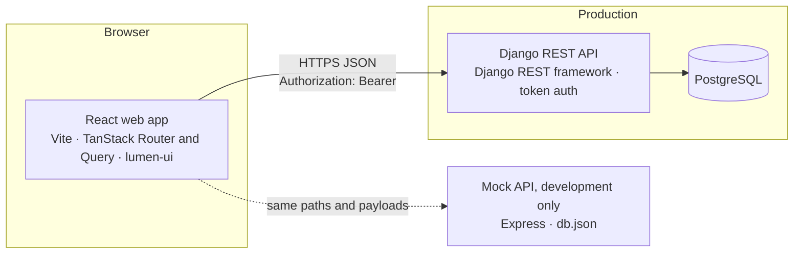
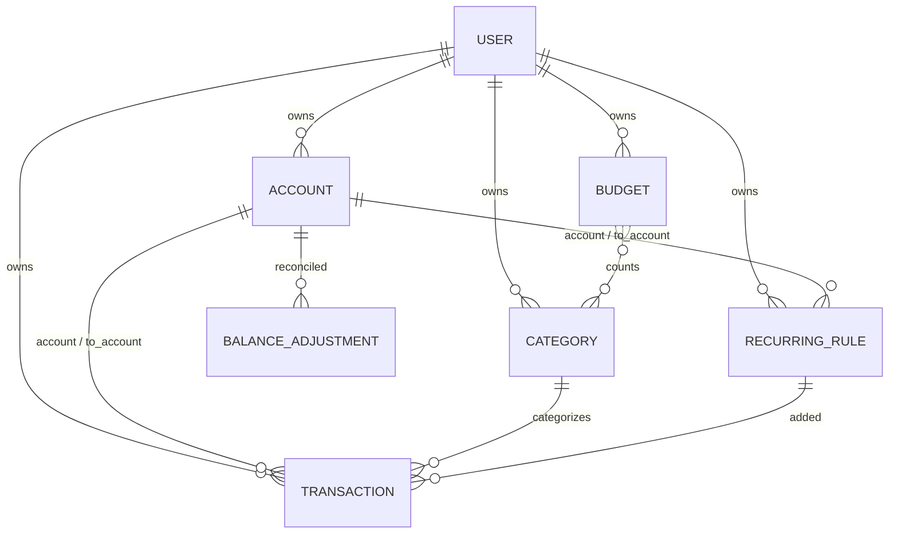

# Expensify — Functional Requirements & Technical Specification

Oct 10, 2026 · Sandip

## 1. Overview

Expensify is a personal tracker for income, expenses and transfers between your own accounts. The React web app in this repository is built and runs against a small Express mock API. The production backend will be a **Django REST framework API on PostgreSQL**, which replaces the mock without changes to the app.

This document does two jobs:

- It describes what the app does today: sections 2 to 6 and 11 to 13.
- It is the contract for the Django backend: the business rules (section 4), the data model (section 8), the REST API (section 9) and the implementation notes (section 10). Where the mock and this document disagree, this document wins.

The dashboard answers three questions for one period at a time: where did my money go, am I within budget, and am I saving more than last month?

### Goals

| Goal | Measure | Target |
| --- | --- | --- |
| Fast entry | Time from opening the form to a saved entry | Under 5 s; Ctrl+Enter saves; "Save and add another" for runs of entries |
| Trustworthy numbers | App balances match real bank, card and cash balances | Any gap fixed in one reconcile step |
| Instant insight | "Spent vs budget this month" visible without digging | On the dashboard |
| Fast load | Dashboard ready on a mid-range phone over 4G | Under 2.5 s |
| Private data | Each user sees only their own records | Enforced by the API on every query |

### Scope

**In scope:** the responsive web app (phone, tablet and desktop browsers); the Django REST API and PostgreSQL database; one currency (Nepali rupees) with Nepali number formatting.

**Out of scope for now:** native mobile apps, bank syncing, multi-currency, offline use, push notifications, receipts, CSV import and backups, shared wallets, Google sign-in and password reset by email. Section 16 lists the backlog.

### Users

| Persona | Main need | Features that serve it |
| --- | --- | --- |
| Salaried professional | Stay within a monthly budget; salary and rent arrive on a schedule | Budgets, recurring rules, dashboard |
| Freelancer | Track irregular income; keep business and personal money apart | Several accounts, income categories, cash flow report |
| Student | Make a small allowance last; mostly cash and a mobile wallet | Quick entry, cash and wallet accounts, daily reminder |

### Glossary

| Term | Meaning |
| --- | --- |
| Account | Where money sits: cash, bank, credit card, mobile wallet, savings, loan or other |
| Liability account | A credit card or loan. Its balance is stored negative while money is owed and shown as a positive "Owed" figure |
| Transaction (entry) | One money movement: income, expense or transfer |
| Transfer | Money moved between two of the user's own accounts; neither income nor expense |
| Category | What money was spent on or earned from; typed as expense or income |
| Budget | A spending limit per week, month or year, for all expenses or chosen categories |
| Recurring rule | A transaction template plus a schedule, such as salary, rent or a subscription |
| Occurrence | One date a recurring rule is due on; it is either added as an entry or skipped |
| Ask-first rule | A recurring rule that waits for the user to confirm or skip each occurrence |
| Period | A date range: a Monday-to-Sunday week, a calendar month, a calendar year or a custom range, both ends included |
| Reconcile | Setting an account's balance to what the bank or wallet really shows |
| Archive | Hide an account or category from pickers while keeping its history; it can be restored |
| Pause | Stop a budget or recurring rule without deleting it |
| Include in total | Whether an account counts toward the total balance |

## 2. What's in the app

Every module below is built in the web app and works against the mock API. The Django API must support all of them (section 15 orders the work).

| Module | What it covers | Main screens |
| --- | --- | --- |
| Authentication and profile | Sign up, log in with username or email, profile and photo, change password, delete account | `/login`, `/signup`, Settings |
| Dashboard | Period summary with change from the previous period, balances, spending by category, budgets, 6-period trend, recent and upcoming entries, privacy mode | `/` |
| Transactions | Add, edit, duplicate and delete income, expenses and transfers; make an entry recurring | Form sheet, `/transactions/:id` |
| Transaction list | Day-grouped history, period presets, filters, search, totals, Excel and PDF export | `/transactions` |
| Accounts | Seven account types with live balances, credit card usage, reconcile, archive, account page | `/accounts`, `/accounts/:id` |
| Categories | Expense and income categories with icons and colors, archive, default set | `/categories` |
| Budgets | Weekly, monthly or yearly limits, rollover, alerts, history by period | `/budgets`, `/budgets/:id` |
| Recurring | Schedules, automatic or ask-first entries, catch-up of missed dates, pause and resume | `/recurring`, `/recurring/:id` |
| Reports | Cash flow, spending by category, category trends, accounts and net worth, budget history; Excel and PDF export | `/reports/*` |
| Alerts and reminders | Budget alerts, recurring reminders, daily reminder, alert list behind the bell, system notifications | Header bell |
| Settings | Profile, password, theme, notification preferences, delete all transactions, delete account | `/settings` |

## 3. Functional requirements

Requirements are numbered per module (AUTH-01…) so tickets, tests and both codebases can point to them. Every requirement in this section is implemented in the web app; "the API" means the Django API must support it as section 9 describes.

### 3.1 Authentication and profile

| ID | Requirement |
| --- | --- |
| AUTH-01 | Sign up with a name (1–60 characters), a username, an email and a password of at least 8 characters. The password field shows a strength checklist as a hint; only the length is enforced. |
| AUTH-02 | A username is 3–30 letters, numbers, dots, dashes or underscores. It is stored lowercase, so "Sita.R" and "sita.r" are one login, and it can never change. |
| AUTH-03 | An email is unique across users, ignoring case. A taken username or email shows its message on that field (API answer 409 with `field`). |
| AUTH-04 | A new account is logged in at once and lands on the dashboard. No verification email is sent and there is no approval step. The API gives a new user the default categories (appendix A) and no accounts; the mock instead shares its one set of data with every user. |
| AUTH-05 | Log in with the username or the email, both case-insensitive, and the password. Wrong details show "Wrong username, email or password." |
| AUTH-06 | The session lasts until the user logs out: the token is kept in the browser (`localStorage` key `auth`). |
| AUTH-07 | A signed-out user who opens a protected page goes to `/login?redirect=<path>` and returns to that page after logging in or signing up. The redirect survives switching between the two pages. Only paths inside the app are followed: `//host`, `/\host` and absolute URLs go to the dashboard instead. |
| AUTH-08 | A logged-in user who opens `/login` or `/signup` goes to the dashboard. |
| AUTH-09 | Any API answer of 403 means the token is missing or invalid: the app logs out and reloads on `/login`, which also clears every cached query. |
| AUTH-10 | Edit the full name (1–60) and email in Settings. The username shows read-only with "You log in with it, so it can't be changed." |
| AUTH-11 | Add, change or remove a profile photo. The device scales the picked image to a 128 px square JPEG and saves it at once; without a photo the avatar shows initials. |
| AUTH-12 | Change the password from Settings or the account menu: the current password (a wrong one shows "That password isn't right" on its field) and a new one of at least 8 characters, different from the current one. |
| AUTH-13 | Delete the account: the user types `DELETE` and enters their password. Every record they own and their login are deleted, this browser's alert history is cleared, and the app lands on `/login?deleted=1` with "Your account and everything in it were deleted." |
| AUTH-14 | Log out from the account menu in the header. |

### 3.2 Dashboard

The dashboard is the first screen after logging in. Every figure follows the totals rules in section 4.

| ID | Requirement |
| --- | --- |
| DSH-01 | Switch the period: This month, Last month or Custom (From and To dates; reversed dates are swapped). The period label reads "September 2026" for a calendar month, otherwise the date range. The choice lives in the URL (`period`, `from`, `to`) and replaces the history entry. |
| DSH-02 | Show income, expense, net and savings rate for the period. Savings rate is net ÷ income as a whole percent, "—" with no income. |
| DSH-03 | Show each summary figure's change from the previous period: the amount and percent ("New" when there was nothing before), and savings rate in points. An arrow and a sign show the direction, never color alone. The change is hidden when the previous period has no income or expense. |
| DSH-04 | Income and Expense open the transaction list filtered to the period and type; Net and Savings rate open it filtered to the period. |
| DSH-05 | Show the total balance (non-archived accounts marked "include in total", with "Across N accounts · M not included") and each active account's balance; cards and loans read "Owed" or "In credit". The total opens Accounts and an account opens its page. |
| DSH-06 | Chart the period's expenses by category as a donut: the top 5 categories plus "Other" when two or more are left over, with the total and entry count in the middle and a list with amounts and shares. A "Table" toggle replaces the list with a table. A slice opens the transaction list filtered to that category ("Other" to all of its categories); uncategorized entries can't be opened. |
| DSH-07 | Show up to 5 active budgets, most used first, with spent of limit, a bar, a state chip, % used and what's safe to spend per day. A row opens the budget's page; "See all" shows when there are more than 5. |
| DSH-08 | Chart income vs expense for the selected period and the 5 before it, with each period's net and a "Table" toggle. The presets use calendar months; a custom range uses earlier ranges of the same length. Clicking a bar selects that period. |
| DSH-09 | List the 5 newest entries of the period. A row opens the entry; its menu offers Edit and Delete; "See all" opens the list for the period. |
| DSH-10 | List recurring occurrences due by today or within the next 7 days, with Confirm and Skip on due ask-first rules. The card is hidden when there are none. |
| DSH-11 | Privacy mode: an eye button masks every amount as "••••", including chart tooltips and axes. Percentages and chart shapes stay. It is remembered per browser, synced across open tabs, and applies to the dashboard only. |
| DSH-12 | Give each card an empty state with its next action. A period with no entries replaces the summary, spending, trend and recent cards with one "Nothing logged in {period}" card. |
| DSH-13 | Layout: one column on phones; two on tablets; on desktop the summary across the top, then balances, spending and budgets, then the trend beside recent entries, then upcoming. The period switcher sticks to the top while scrolling. |

### 3.3 Transactions

| ID | Requirement |
| --- | --- |
| TXN-01 | Add an expense, income or transfer with an amount above 0, an account, a date and an optional note of up to 500 characters (a blank note is saved as none). Expenses and income need a category of their type; transfers need a different "to" account and have no category. Entries have no payee, tags, time of day, receipts or splits. |
| TXN-02 | A new entry starts as an expense dated today, on the account this device used last while it's still active, otherwise the first active account. The date has Today and Yesterday shortcuts and accepts any date. |
| TXN-03 | Pickers show active categories and accounts, plus an archived one the entry already uses, marked "(archived)". The category grid shows 8 tiles when there are more than 9, with "Show all N categories". |
| TXN-04 | With no categories of the chosen type, the form offers "Add default categories". With no active accounts, the app asks for an account first and then opens the form on it. |
| TXN-05 | "Save and add another" keeps the type, account and date and clears the rest. Ctrl/⌘+Enter saves; Ctrl/⌘+Shift+Enter saves and adds another. |
| TXN-06 | Edit any field. The API reverses the old entry's effect on balances and applies the new one, including when the type or accounts change. |
| TXN-07 | Delete after a confirmation that says what happens to the balance; there is no undo. |
| TXN-08 | Duplicate an entry into the add form, dated today. |
| TXN-09 | "Make recurring" opens the recurring rule form filled from the entry, repeating monthly from one period after its date. An entry added by a rule that still exists offers "Open recurring rule" instead and shows a "Recurring" chip. |
| TXN-10 | A future-dated entry changes balances at once and shows an "Upcoming" chip. |
| TXN-11 | The entry page (`/transactions/:id`) shows the amount, type, category and account (or from and to accounts), date, when it was added and last edited, and the note, with Edit, Duplicate, Make recurring and Delete. |
| TXN-12 | Entries whose account or category was deleted keep working and show "Deleted account" or "Deleted category". |

### 3.4 Transaction list, search and export

| ID | Requirement |
| --- | --- |
| LST-01 | Pick the period: This month (default), Last month, This year or Custom. Phones get a select, wider screens a segmented control. |
| LST-02 | Load the whole period in one request and filter it on the device by type, accounts (either side of a transfer, archived ones included), categories (of the chosen type; hidden for transfers) and an inclusive amount range (swapped if reversed). A badge counts the active filters and removable chips show them, with "Clear all". |
| LST-03 | Search the note, category name and account name. Every typed word must match, ignoring case. |
| LST-04 | Show income, expense and net totals for what's on screen; transfers don't count. |
| LST-05 | From 1,024 px wide, show a table grouped by day with each day's net: Date, Description, Category, Account, Amount and an actions column. Columns sort ascending, descending or not at all; day headers show only while unsorted. Narrower screens show day-grouped rows with a menu. |
| LST-06 | Accept drill-downs in the URL: `from`, `to`, `type`, `category` and `account` (one id, or several as `"4,7"`). Invalid values are dropped, and the sidebar's plain link resets the page. Changes made on the page are not written back to the URL. |
| LST-07 | Export what's on screen, oldest first, to Excel or PDF (appendix B). With nothing to export, a message shows and no file is made. |
| LST-08 | Empty states: "No matches" with a button to clear search and filters, or "No transactions in {period}" with Add and "Show this month". |

### 3.5 Accounts

| ID | Requirement |
| --- | --- |
| ACC-01 | Create an account with a name (1–40), a type (cash, bank, credit card, mobile wallet, savings, loan, other; default cash), an opening balance that may be negative, and "include in total" (default on). Cards and loans enter the amount owed as a positive figure, stored negative. Credit cards take an optional credit limit above 0. |
| ACC-02 | Each account's icon and color come from its type (appendix A); there is no picker. Every account is in NPR; there is no currency choice. |
| ACC-03 | List the total balance (red when negative), the active accounts in creation order, and an "Archived (N)" section. |
| ACC-04 | Each account shows its balance; cards and loans show "Owed" or "In credit". A card with a limit shows a "Credit used" bar: accent under 80%, warning from 80%, error from 100%. Chips mark "Archived" and "Not in total". |
| ACC-05 | Edit any field, including the type. Changing the opening balance moves the current balance by the same difference. On a type change the icon and color follow the new type only while they are still the old type's defaults. |
| ACC-06 | Reconcile: the user enters the real balance (or amount owed); the form shows the in-app figure and the adjustment, and saving sets the current balance to it. No transaction is created, so reports and budgets don't see the adjustment. |
| ACC-07 | Archive an account: it leaves pickers, the dashboard and the total but keeps its history, and can be restored. A confirmation shows first when its balance isn't zero. Archived accounts can't be edited or reconciled until restored. |
| ACC-08 | Delete an account after a confirmation that suggests archiving instead. Deleting is allowed while entries use it; they keep it and show "Deleted account". |
| ACC-09 | The account page shows the current balance, opening balance and credit limit with % used, and every entry touching the account (either side of a transfer) grouped by day with each day's net, with an Add button set to the account. |

### 3.6 Categories

| ID | Requirement |
| --- | --- |
| CAT-01 | Keep separate expense and income lists, shown as tabs. |
| CAT-02 | Create a category with a type, a name (1–30, unique within its type ignoring case; archived categories count) and one of 48 built-in icons. A new category gets a random color from a 12-color palette, preferring colors its type doesn't use yet; there is no color picker. |
| CAT-03 | Rename a category and change its icon. Its type can't change after creation. |
| CAT-04 | Archive and restore: archived categories leave pickers, and entries that use them keep them. |
| CAT-05 | Delete after a confirmation that suggests archiving instead. Deleting is allowed while entries use it; they show "Deleted category", and budgets that counted it show "Deleted categories" until they're saved again. |
| CAT-06 | "Add default categories" adds the defaults in appendix A that the user doesn't have, matched by type and name, or says "Nothing to add". It is offered on the empty Categories page and in the transaction form. |
| CAT-07 | Categories list by `sortOrder`, then name; a new one goes to the end of its type. There is no reordering and no subcategories. |

### 3.7 Budgets

| ID | Requirement |
| --- | --- |
| BUD-01 | Create a budget with a period (weekly, monthly or yearly; default monthly), a limit above 0, expense categories (none means every expense), a name (1–40) that follows the chosen categories until typed ("All expenses", "Food", "Food & Transport", "Food & 2 more"), "Roll over what's left" (default off) and "Alert me at 80% and 100%" (default on). |
| BUD-02 | Show spent of limit, % used (rounded down), state (on track, warning, over), what's left or over, days left, and what's safe to spend per day (section 4). |
| BUD-03 | Rollover adds last period's unspent amount to this period's limit, or takes an overspend off it, never below 0 (BR-10). |
| BUD-04 | List active budgets ("All expenses" ones first, then by name) and a "Paused (N)" section. |
| BUD-05 | The budget page shows the current period and its past results: 8 weeks, 6 months or 2 years. Periods before the budget was created are marked. Selecting a period lists the expenses it counted, 50 at a time. |
| BUD-06 | Pause and resume without a confirmation: a paused budget keeps its settings but shows no progress and sends no alerts. Delete after a confirmation; transactions are untouched. |
| BUD-07 | Alert once per threshold per period (NTF-01). |

### 3.8 Recurring transactions

| ID | Requirement |
| --- | --- |
| REC-01 | Create a rule from scratch or from a transaction ("Make recurring"). A rule holds a template (type, amount, account or from and to accounts, category, note), a schedule, an end and a mode. |
| REC-02 | Schedules repeat daily, weekly on chosen weekdays, monthly on day 1–31 or the last day, or yearly, every N periods (1–99), from a start date (BR-12). |
| REC-03 | A rule ends never, after N entries (1–999), or on a date on or after the start. |
| REC-04 | On the due date the rule either adds the entry automatically (default) or asks first. |
| REC-05 | The form previews the next 3 dates. A new rule with a past start date says how many entries up to today it will add, or leave waiting. |
| REC-06 | Automatic rules add every due date up to today, oldest first, in writes of at most 100, including dates missed while the app was closed. Each date is added exactly once, even with several tabs open (BR-13). |
| REC-07 | Ask-first occurrences wait under "Waiting for you" on the Recurring page and on the dashboard: Confirm adds the entry, Skip passes over it, and Edit adds it as edited (its date may change). Each acts on the oldest due date. The sidebar's Recurring item shows how many are waiting. |
| REC-08 | Edits apply to future entries only. The next due date is recomputed only when the schedule changes, counting from the earlier of the old next due date and today, so a waiting entry isn't lost. |
| REC-09 | Pause and resume. Resuming skips dates that passed while paused. An ended rule can't be paused; editing its end runs it again. |
| REC-10 | Delete after a confirmation; entries already added stay. |
| REC-11 | A rule is active, paused, ended, or blocked because an account it uses was deleted; a blocked rule adds nothing and asks to be edited. |
| REC-12 | The rule page shows the amount, schedule, details, the next 5 dates and the entries it added, 50 at a time. |

### 3.9 Reports

| ID | Requirement |
| --- | --- |
| RPT-01 | A Reports page lists five reports as cards, each with "Excel · PDF" and "Open report". |
| RPT-02 | Every report keeps its filters in the URL, offers Reset, states what it shows in one line, exports to Excel and PDF (appendix B), and drills down to the transaction list where a figure stands for entries. |
| RPT-03 | Period presets for the first four reports: this month, last month, last 3, 6 or 12 months (including the current one), this year, last year, custom. |
| RPT-04 | **Cash flow** (`/reports/cash-flow`): income, expense, net and savings rate by week, month or year for chosen accounts (default last 12 months by month), with tiles, a chart and a table with a running net and totals. |
| RPT-05 | **Spending by category** (`/reports/categories`): expense or income per category against the previous period (BR-06), with tiles, a donut of the top 6 plus Other, the 5 biggest changes and a table of every category. |
| RPT-06 | **Category trends** (`/reports/category-trends`): a category-by-month table (at most the last 24 months) with shaded cells, filtered by type, accounts and categories; a cell opens that month's entries. |
| RPT-07 | **Accounts and net worth** (`/reports/accounts`): an account statement (opening, income, expense, transfers in and out, closing, change) and assets, liabilities and net worth at the end of each week, month or year. Balances are worked back from the current balance (BR-17). Without a chosen account it covers the accounts in the total. |
| RPT-08 | **Budget history** (`/reports/budgets`): every budget's hit rate, periods over and overspend, or one budget's periods with limit, carry, spent, remaining and state, looking back 6, 12 or 24 periods, optionally with paused budgets and periods before a budget started. |
| RPT-09 | Reports follow the totals rules (section 4): transfers are left out of income, expense and category figures, but count as money in and out on account statements. |

### 3.10 Alerts and reminders

| ID | Requirement |
| --- | --- |
| NTF-01 | Budget alerts: when a budget reaches 80% or 100% of its limit, alert once per threshold per period, and only the higher one if both are crossed at once. The threshold is recorded on the server (`lastAlert`) before the alert shows, so other tabs and reloads don't repeat it. Paused budgets and budgets with alerts off never alert. |
| NTF-02 | Daily reminder (opt-in): at a chosen half-hour, if nothing but recurring entries is dated today, remind the user to log their spending. If the app opens after that time, it reminds then. At most once a day. |
| NTF-03 | Recurring reminders for ask-first rules: the day before a date, and when entries are waiting (one reminder for a catch-up of several). Each is shown once. |
| NTF-04 | Turn each kind on or off in Settings, and pick the reminder time. |
| NTF-05 | Deliver alerts as an 8-second toast while the tab is visible, or as a system notification while it's hidden if the user allowed notifications. Clicking either opens the alert's page. |
| NTF-06 | Keep alerts in a list behind the header's bell: an unread badge, newest first, at most 50 for at most 30 days, per browser and shared by open tabs. Opening the list marks everything read; an alert can be removed, or all cleared. |
| NTF-07 | All of this runs only while the app is open in a browser. Alert history and reminder state stay on the device and aren't synced. |

### 3.11 Settings

| ID | Requirement |
| --- | --- |
| SET-01 | Settings has four sections: Profile, Appearance, Notifications, and Data and privacy. |
| SET-02 | Theme: light, dark or system. It changes at once, is saved on the profile, goes back if the save fails, and is also kept in the browser so the first paint and the login page use it. |
| SET-03 | Notifications: the three switches of NTF-04, the reminder time, and the browser permission state with an "Allow notifications" button. |
| SET-04 | Delete all transactions after a confirmation that shows the count. Each account's balance goes back to where it was without them; accounts, categories, budgets and recurring rules stay. |
| SET-05 | Delete the account (AUTH-13). |

### 3.12 App shell

| ID | Requirement |
| --- | --- |
| APP-01 | The sidebar lists Dashboard, Transactions, Accounts, Budgets, Reports, Recurring, Categories and Settings. On desktop it collapses to icons; at 768 px and below it becomes a drawer. |
| APP-02 | The header holds the sidebar toggle, the alerts bell and the account menu (avatar, name, email, Change password, Logout). |
| APP-03 | Forms open as sheets: a bottom drawer on phones (under 600 px), a centered dialog on wider screens. Confirmations are always a dialog. |
| APP-04 | Pages sit in one centered column up to 1,200 px wide. Only the content pane scrolls, and Back restores its position. |

## 4. Business rules

Every balance change comes from one effect table, and every total follows the same rules, so the dashboard, budgets and reports always agree. The web app computes totals; the API stores entries and moves balances. Both must follow these rules exactly.

### Balance effects

| Type | Source account | Destination account | Counts toward |
| --- | --- | --- | --- |
| Income | + amount | — | Income totals and income categories |
| Expense | − amount | — | Expense totals, expense categories and budgets |
| Transfer | − amount | + amount | Nothing; it only moves money |

An account's current balance = its opening balance + the effects of all its entries + any reconcile adjustments. Creating an entry applies its effects; deleting one reverses them; editing one reverses the old effects and applies the new ones. Each of these happens in one database transaction with the entry write. For example, changing a Rs 30 Cash expense to Rs 45 from Bank moves Cash +30 and Bank −45 together.

### Rules

| ID | Rule |
| --- | --- |
| BR-01 | Amounts are decimals in the account's currency with 2 decimal places: `NUMERIC(14,2)` in PostgreSQL, JSON numbers on the wire, never binary floats on the server. The app sums in thousandths so 0.1 + 0.2 stays 0.3. |
| BR-02 | `amount` is always positive; `type` gives the direction. |
| BR-03 | One currency: every account is NPR. Amounts show the Nepali way with the `en-IN` locale: "Rs 12,34,567.50", compact "Rs 1.2L" on chart axes. |
| BR-04 | Net = income − expense. Savings rate = net ÷ income × 100, a whole percent; "—" when income is 0. Transfers are never income or expense. |
| BR-05 | Dates are the user's local calendar date written `YYYY-MM-DD`. The server stores them as `DATE` and never converts them, so an entry never moves to another day. The device decides what "today" is. |
| BR-06 | Weeks run Monday to Sunday; months and years follow the calendar; custom ranges include both ends. "Last N months" includes the current month. A period's previous period is the year, month or run of whole months before it, otherwise the same number of days before it. |
| BR-07 | A budget's spent = the sum of expenses in its categories (or all expenses) dated within the period. Income and transfers never count. |
| BR-08 | Budget state from % used: under 80 is on track, 80–99 is warning, 100 or more is over. Thresholds are compared without rounding (spent × 100 ≥ threshold × limit) and % used shows rounded down, so 79.6% reads 79%, on track. A zero limit shows "—" and is over. |
| BR-09 | Safe to spend per day = remaining ÷ days left in the period (today included), rounded down to the paisa; 0 when nothing is left. |
| BR-10 | Rollover: this period's limit = amount + (amount − the previous period's spent), never below 0. It reaches back one period only and takes nothing from a period that ended before the budget was created. |
| BR-11 | Budget alerts: each threshold alerts once per period. `lastAlert` holds the highest threshold alerted in the period starting on `periodStart` and is never lowered for the same period. |
| BR-12 | Recurring schedules: the first entry falls on the first schedule date on or after the start date. Daily rules count every N days from the start date. Weekly rules use the chosen ISO weekdays (1 = Monday … 7 = Sunday; none means the start date's weekday), every N weeks counted in Monday-to-Sunday weeks from the start week. Monthly rules use day 1–31, every N months from the start month, and days 29–31 fall on the last day of shorter months. Yearly rules repeat the start date's day and month, and 29 February falls on the 28th in common years. |
| BR-13 | Recurring occurrences are handled oldest first, starting at `nextDueDate`. Each date is handled exactly once, either added or skipped; skipped dates don't count toward an "after N entries" end. Handling moves `nextDueDate` to the next schedule date. A rule ends when its count is reached or its next date is after its end date. |
| BR-14 | Percentages show as whole numbers rounded half up, except budget % used (BR-08). A change from nothing reads "New". |
| BR-15 | Text limits: account name 1–40, category name 1–30, budget name 1–40, note up to 500, user name 1–60. Names are trimmed. |
| BR-16 | Credit cards and loans are liabilities: what is owed is stored as a negative balance and shown as a positive "Owed". Credit used = owed ÷ credit limit. |
| BR-17 | An account's balance at the end of day D = its current balance − the effects of every entry dated after D, future-dated ones included. Net worth = assets (balances above 0) − liabilities (balances below 0, as positive amounts). |
| BR-18 | Future-dated entries change balances when they are saved and show as "Upcoming". |

## 5. User stories and acceptance criteria

Each acceptance criterion should become one end-to-end test against the Django API.

| ID | Story | Acceptance criteria |
| --- | --- | --- |
| US-01 | As a user, I log an expense in a few taps so I don't skip logging. | From any page, Add transaction opens the form with Expense, today and my last account. After an amount, a category and Save, the entry tops today's list and the account balance drops by the amount. |
| US-02 | I move money between my accounts. | With Bank at Rs 1,000 and Cash at Rs 50, a Rs 200 transfer from Bank to Cash leaves Bank at Rs 800 and Cash at Rs 250. This month's income and expense don't change. |
| US-03 | I fix a wrong entry. | Changing a Rs 30 Cash expense to Rs 45 from Bank leaves Cash Rs 30 higher and Bank Rs 45 lower than before the edit. |
| US-04 | I'm warned before I overspend. | A monthly Food budget of Rs 500 has Rs 380 spent. A Rs 50 Food expense shows the warning state (86%) and one 80% alert; later Food expenses that month raise no second 80% alert, and crossing Rs 500 raises one 100% alert. |
| US-05 | My salary logs itself. | A monthly automatic rule "Salary Rs 50,000 on day 1" adds exactly one income dated the 1st when the app is open that day, even in two tabs. If the app isn't opened until the 3rd, the entry is added then, still dated the 1st. |
| US-06 | Rent waits for me. | An ask-first rent rule due today shows under "Waiting for you" and on the dashboard, and the sidebar badge reads 1. Confirm adds one entry; Skip adds none; either clears the badge. |
| US-07 | My balance matches the bank. | Bank reads Rs 12,000 in the app; reconciling to Rs 11,500 sets it to Rs 11,500 and changes no report or budget figure. |
| US-08 | I start the moment I sign up. | A new sign-up lands on the dashboard with no approval step, sees none of another user's data, and finds the default categories ready. |
| US-09 | I delete my account. | After typing DELETE and my password, my records and login are gone and I'm on `/login?deleted=1`. Logging in with the old details fails. |
| US-10 | My data is mine. | User A can't read, change or delete user B's records: every request for B's IDs answers 404. |

## 6. Non-functional requirements

| ID | Area | Requirement |
| --- | --- | --- |
| NFR-01 | Performance | Dashboard ready in under 2.5 s on a mid-range phone over 4G; route changes under 300 ms. |
| NFR-02 | Performance | API list endpoints answer in under 300 ms at the 95th percentile for a year of entries (about 5,000) per user. |
| NFR-03 | Performance | Routes are code-split; the PDF library loads on the first PDF export. |
| NFR-04 | Scalability | 50,000 transactions per user and any number of users without a schema change; every query is scoped to one user and indexed. |
| NFR-05 | Responsive | Usable from 320 px to 1,920 px wide, with breakpoints at 600 px (phone), 768 px (sidebar drawer) and 1,024 px (desktop table and dashboard grid). |
| NFR-06 | Accessibility | WCAG 2.2 AA: keyboard access, visible focus, labels, 4.5:1 text contrast. Income and expense never rely on color alone; each also has a sign and an icon. Dashboard charts have a table view; report charts sit beside tables of the same figures. |
| NFR-07 | Security | HTTPS only. Passwords hashed by Django (PBKDF2 or Argon2). Random tokens sent as `Authorization: Bearer`. Every query filtered by the requesting user; another user's ID answers 404. Login and signup are rate-limited. CORS allows only the app's origin. Secrets come from the environment, never the repository; `DEBUG` is off in production. |
| NFR-08 | Privacy | No amounts, notes or names in logs or analytics. Deleting an account removes every record the user owns. |
| NFR-09 | Integrity | An entry write and its balance changes commit together in one database transaction. A management command recomputes balances from entries and reports any drift. |
| NFR-10 | Compatibility | The last 2 versions of Chrome, Edge, Firefox, Safari (macOS and iOS) and Samsung Internet. |
| NFR-11 | Localization | English UI. Money always in the `en-IN` format; dates in the browser's language. |
| NFR-12 | Maintainability | Strict TypeScript and ESLint on the web app; Ruff on the API. Domain rules (section 4) covered by unit tests on both sides. |
| NFR-13 | Observability | Structured request logs on the API; error reporting (such as Sentry) on both the app and the API. |

## 7. Architecture

The web app is a single-page React app that talks JSON over HTTPS to one REST API. During development that API is the Express mock in `mock-server/`; in production it is Django on PostgreSQL. The app switches between them with one setting, `VITE_API_BASE_URL`.



The work splits like this:

- **The app** decides what "today" is, works out periods, recurring dates and alerts, and computes every total and chart from lists of entries.
- **The API** stores the data, validates every write, moves account balances in the same database transaction as the entry, keeps each user's data apart, and makes sure each recurring date is handled once.

### Key decisions

| Decision | Choice | Why |
| --- | --- | --- |
| Backend | Django + Django REST framework | Mature auth, ORM, migrations and admin; the team's choice |
| Database | PostgreSQL | Exact `NUMERIC` money, `DATE` columns, check constraints, partial unique indexes and array columns |
| API shape | REST and JSON, with the mock's paths and payloads | The app moves to Django by changing `VITE_API_BASE_URL` only |
| Authentication | DRF tokens sent as `Bearer`; 403 when missing or invalid | Matches the app's interceptor, which logs out on 403 |
| Money | `NUMERIC(14,2)`, sent as JSON numbers | Exact on the server; the app already handles plain numbers |
| Dates | `DATE` columns, `YYYY-MM-DD` on the wire | No time zone shifts |
| Balances | Stored on the account and changed with the entry in one transaction | Cheap reads; a repair command handles drift |
| Totals and charts | Computed in the browser from a period's entries | Keeps the API simple; aggregate endpoints can come later if reports slow down |
| Recurring entries | Added by the app through `occurrences` and `skip`, with the server refusing stale dates | Matches the app today; a server job can come later (section 12) |
| Deleting used accounts and categories | Soft delete | Old entries keep their references and foreign keys stay valid |
| IDs | Integers (`bigint` identity) | The app expects numbers |
| Web UI | React 19, lumen-ui, TanStack Router and Query | Section 11 |
| Web hosting | Netlify, built from `main`, with a deploy preview per pull request | A static single-page app needs no server; Django runs on its own host (section 14) |

## 8. PostgreSQL data model

Every table except `users` has a `user_id` that cascades on delete, and every API query filters on it. Columns are snake_case; the API turns them into camelCase JSON. Timestamps are `timestamptz` in UTC. Amounts are `NUMERIC(14,2)`, which holds up to 999,999,999,999.99.



### users

A custom user model (`users.User`, extending Django's `AbstractUser`) created before the first migration. Its `first_name` and `last_name` columns go unused.

| Column | Type | Notes |
| --- | --- | --- |
| id | bigint | primary key |
| username | varchar(30) | unique; lowercase, `^[a-z0-9._-]{3,30}$`; never changes |
| email | varchar(254) | unique on `lower(email)` |
| name | varchar(60) | full name, trimmed |
| password | varchar(128) | Django's password hash |
| photo_url | text, null | `data:image/(jpeg\|png\|webp);base64,…`, at most 200,000 characters |
| theme | varchar(6) | light · dark · system; default system |
| daily_reminder | boolean | default false (opt-in) |
| reminder_time | varchar(5) | `HH:mm`, 24-hour; default `20:00` |
| budget_alerts | boolean | default true |
| bill_reminders | boolean | default true |
| date_joined, last_login | timestamptz | Django's own |

### accounts

| Column | Type | Notes |
| --- | --- | --- |
| id | bigint | primary key |
| user_id | bigint | → users, on delete cascade |
| name | varchar(40) | trimmed, not empty |
| type | varchar(12) | cash · bank · credit_card · wallet · savings · loan · other |
| currency | char(3) | default `NPR` |
| opening_balance | numeric(14,2) | may be negative |
| current_balance | numeric(14,2) | server-owned; section 4 |
| credit_limit | numeric(14,2), null | credit cards only; above 0 |
| icon | varchar(40) | lumen-ui icon name (appendix A) |
| color | char(7) | `#RRGGBB` |
| include_in_total | boolean | default true |
| archived | boolean | default false |
| sort_order | integer | creation order within the user |
| deleted_at | timestamptz, null | soft delete (ACC-08) |
| created_at, updated_at | timestamptz | |

Index on `(user_id, sort_order)` where `deleted_at is null`.

### categories

| Column | Type | Notes |
| --- | --- | --- |
| id | bigint | primary key |
| user_id | bigint | → users, on delete cascade |
| name | varchar(30) | trimmed, not empty |
| type | varchar(7) | expense · income; fixed after creation |
| icon | varchar(40) | lumen-ui icon name |
| color | char(7) | `#RRGGBB` |
| archived | boolean | default false |
| sort_order | integer | position within its type |
| deleted_at | timestamptz, null | soft delete (CAT-05) |
| created_at, updated_at | timestamptz | |

Unique index on `(user_id, type, lower(name))` where `deleted_at is null`, so archived categories count but deleted ones free their name.

### transactions

| Column | Type | Notes |
| --- | --- | --- |
| id | bigint | primary key |
| user_id | bigint | → users, on delete cascade |
| type | varchar(8) | expense · income · transfer |
| amount | numeric(14,2) | check `amount > 0` |
| currency | char(3) | copied from the source account |
| account_id | bigint | → accounts, on delete restrict; the source account |
| to_account_id | bigint, null | → accounts, on delete restrict; transfers only |
| category_id | bigint, null | → categories, on delete restrict; null for transfers |
| date | date | the user's local date |
| note | varchar(500), null | trimmed; empty becomes null |
| recurring_rule_id | bigint, null | → recurring_rules, on delete set null |
| created_at, updated_at | timestamptz | |

A check constraint keeps the shape right: a transfer has `to_account_id`, no category and two different accounts; income and expense have a category and no `to_account_id`. Indexes: `(user_id, date desc, created_at desc, id desc)`, `(account_id)`, `(to_account_id)`, `(recurring_rule_id)`.

### budgets and budget_categories

| Column | Type | Notes |
| --- | --- | --- |
| id | bigint | primary key |
| user_id | bigint | → users, on delete cascade |
| name | varchar(40) | trimmed, not empty |
| amount | numeric(14,2) | limit per period; above 0 |
| period | varchar(7) | weekly · monthly · yearly |
| rollover | boolean | BR-10 |
| alert_thresholds | smallint[] | whole percentages 1–1,000, unique and sorted; default `{80,100}`; empty means no alerts |
| last_alert_period_start | date, null | with the next column, `lastAlert` in the API (BR-11) |
| last_alert_threshold | smallint, null | |
| active | boolean | false while paused |
| created_at, updated_at | timestamptz | |

`budget_categories (budget_id, category_id)` is the many-to-many table of expense categories a budget counts; no rows means every expense. Soft-deleted categories keep their rows, so the app can show "Deleted categories".

### recurring_rules

| Column | Type | Notes |
| --- | --- | --- |
| id | bigint | primary key |
| user_id | bigint | → users, on delete cascade |
| type, amount, account_id, to_account_id, category_id, note | as in transactions | the template; the API nests them as `template` |
| frequency | varchar(7) | daily · weekly · monthly · yearly |
| interval | smallint | 1–99 |
| weekdays | smallint[] | weekly rules: ISO 1–7, at least one; empty otherwise |
| day_of_month | smallint, null | monthly rules: 1–31; null otherwise |
| start_date | date | |
| end_type | varchar(5) | never · count · until |
| end_date | date, null | `until` rules; on or after `start_date` |
| max_count | integer, null | `count` rules; 1–999 |
| mode | varchar(7) | auto · confirm |
| next_due_date | date | the next schedule date not yet added or skipped |
| occurrences | integer | entries added so far; default 0 |
| active | boolean | false while paused |
| created_at, updated_at | timestamptz | |

Index on `(user_id, active, next_due_date)`.

### balance_adjustments (recommended)

The app's reconcile only needs the new balance, but recording each adjustment lets the repair command recompute balances exactly (NFR-09).

| Column | Type | Notes |
| --- | --- | --- |
| id | bigint | primary key |
| user_id | bigint | → users, on delete cascade |
| account_id | bigint | → accounts, on delete cascade |
| amount | numeric(14,2) | actual balance − current balance at the time; may be negative |
| created_at | timestamptz | |

### authtoken_token

DRF's token table: one 40-character random key per user, created at signup and looked up on every request.

## 9. REST API contract

This is the contract the web app is built against. `mock-server/server.js` implements all of it and is the reference when a detail isn't written here.

### 9.1 Conventions

| Topic | Rule |
| --- | --- |
| Base URL | The app's `VITE_API_BASE_URL`. Mounting the API under `/api` works: set `VITE_API_BASE_URL=https://example.com/api`. The paths below are relative to it. |
| Trailing slashes | None: `/accounts`, never `/accounts/`. |
| Format | JSON in and out, UTF-8, camelCase keys. Lists are plain arrays with no envelope and no pagination. |
| Authentication | `Authorization: Bearer <token>` on every endpoint except the two under `/auth`. |
| IDs | Integers, in paths and bodies. |
| Dates | `YYYY-MM-DD` strings, validated as real calendar dates (2026-02-30 is refused). |
| Timestamps | ISO 8601 in UTC, fixed width and ending in `Z`, such as `2026-10-10T07:10:33.375000Z`. The app compares them as strings. |
| Money | JSON numbers with at most 2 decimals: `1234.5`, never `"1234.50"`. |
| Errors | Every 4xx and 5xx body is `{ "message": "..." }`. A 409 for a taken value adds `"field"`. The app shows `message` to the user. |
| Ownership | Another user's record, or a soft-deleted one, answers 404, never 403. |

| Status | When |
| --- | --- |
| 200 | A read or an update |
| 201 | A create; also `POST /categories/defaults` when it adds something, and `POST /recurring/:id/occurrences` |
| 204 | A delete, or a password change |
| 400 | Invalid input; `message` says what's wrong |
| 401 | A wrong password at login, password change or account deletion. The app stays logged in. |
| 403 | **Only** a missing, invalid or expired token. The app logs out on any 403, so nothing else may use it. |
| 404 | Not found, not the user's, or an unknown route |
| 409 | A taken username or email, or a recurring date already handled |
| 429 | Too many login or signup attempts |

### 9.2 Objects

**Profile** (the signed-in user)

```json
{
  "id": 2,
  "name": "Sita Rai",
  "username": "sita.r",
  "email": "sita@example.com",
  "photoUrl": null,
  "preferences": {
    "theme": "system",
    "notifications": {
      "dailyReminder": false,
      "reminderTime": "20:00",
      "budgetAlerts": true,
      "billReminders": true
    }
  }
}
```

**Account**

```json
{
  "id": 3,
  "name": "Credit card",
  "type": "credit_card",
  "currency": "NPR",
  "openingBalance": -15000,
  "currentBalance": -18250.5,
  "creditLimit": 100000,
  "icon": "card",
  "color": "#AB20A9",
  "includeInTotal": true,
  "archived": false,
  "sortOrder": 2,
  "createdAt": "2026-10-01T04:15:00.000000Z",
  "updatedAt": "2026-10-09T12:40:11.208000Z"
}
```

**Category**

```json
{
  "id": 4,
  "name": "Groceries",
  "type": "expense",
  "icon": "cart",
  "color": "#15803D",
  "archived": false,
  "sortOrder": 1,
  "createdAt": "…",
  "updatedAt": "…"
}
```

**Transaction**

```json
{
  "id": 120,
  "type": "expense",
  "amount": 1250,
  "currency": "NPR",
  "accountId": 1,
  "toAccountId": null,
  "categoryId": 4,
  "date": "2026-10-09",
  "note": "Weekly vegetables",
  "recurringRuleId": null,
  "createdAt": "…",
  "updatedAt": "…"
}
```

**Budget**

```json
{
  "id": 5,
  "name": "Food & Groceries",
  "amount": 15000,
  "period": "monthly",
  "categoryIds": [1, 4],
  "rollover": false,
  "alertThresholds": [80, 100],
  "lastAlert": { "periodStart": "2026-10-01", "threshold": 80 },
  "active": true,
  "createdAt": "…",
  "updatedAt": "…"
}
```

**Recurring rule**

```json
{
  "id": 7,
  "template": {
    "type": "income",
    "amount": 50000,
    "accountId": 2,
    "toAccountId": null,
    "categoryId": 18,
    "note": "Salary"
  },
  "frequency": "monthly",
  "interval": 1,
  "weekdays": [],
  "dayOfMonth": 1,
  "startDate": "2026-01-01",
  "endType": "never",
  "endDate": null,
  "maxCount": null,
  "mode": "auto",
  "nextDueDate": "2026-11-01",
  "occurrences": 10,
  "active": true,
  "createdAt": "…",
  "updatedAt": "…"
}
```

The server owns `id`, `currentBalance`, `archived`, `sortOrder`, `currency` on transactions, `recurringRuleId`, `lastAlert`, `active`, `occurrences` and the timestamps. Create and update bodies leave them out, and the server ignores them if sent.

### 9.3 Auth

| Method and path | Body | Answer | Rules |
| --- | --- | --- | --- |
| `POST /auth/login` | `{ usernameOrEmail, password }` | 200 `{ token, user: Profile }` | Matches the username or the email, trimmed and ignoring case. 400 when either is missing; 401 "Wrong username, email or password." |
| `POST /auth/register` | `{ name, username, email, password }` | 201 `{ token, user: Profile }` | AUTH-01 to AUTH-03. 409 `field: "username"` "That username is taken. Try another one."; 409 `field: "email"` "There's already an account with this email. Log in instead." Creates the user, the token and the default categories (appendix A) in one transaction; no accounts. |

Neither endpoint authenticates: a stale token sent along must not cause a 403.

### 9.4 Profile

| Method and path | Body | Answer | Rules |
| --- | --- | --- | --- |
| `GET /me` | | Profile | |
| `PATCH /me` | `{ name?, email?, photoUrl? }` | Profile | Only the fields sent change; the username never does. Name 1–60; a valid email; `photoUrl` a JPEG, PNG or WebP data URL up to 200,000 characters, or null to remove. 409 `field: "email"` "That email belongs to another account." |
| `PATCH /me/preferences` | `{ theme?, notifications?: { dailyReminder?, reminderTime?, budgetAlerts?, billReminders? } }` | Profile | Merges what was sent. `reminderTime` is `HH:mm`, 24-hour. |
| `POST /me/password` | `{ currentPassword, newPassword }` | 204 | New password at least 8 characters. 401 "That password isn't right" when the current one is wrong. Keeps the current token valid. |
| `DELETE /me` | `{ password }` | 204 | 401 "That password isn't right". Deletes the user and everything they own, and their token. |

### 9.5 Accounts

| Method and path | Body | Answer | Rules |
| --- | --- | --- | --- |
| `GET /accounts` | | Account[] | By `sortOrder`; archived included, deleted left out |
| `GET /accounts/:id` | | Account | 404 when deleted |
| `POST /accounts` | `{ name, type, currency, openingBalance, creditLimit, icon, color, includeInTotal }` | 201 Account | Name 1–40; type from the list; currency 3 capital letters; color `#RRGGBB`; `creditLimit` null or above 0, kept for credit cards only. `currentBalance` starts at `openingBalance`; `sortOrder` goes after the last. |
| `PUT /accounts/:id` | same as POST | Account | `currentBalance` moves by the new opening balance minus the old one. |
| `PATCH /accounts/:id/archived` | `{ archived }` | Account | |
| `POST /accounts/:id/reconcile` | `{ actualBalance }` | Account | Sets `currentBalance` to `actualBalance` (any number) and records the difference in `balance_adjustments`. |
| `DELETE /accounts/:id` | | 204 | Soft delete; entries and rules that use it keep it. |

### 9.6 Categories

| Method and path | Body | Answer | Rules |
| --- | --- | --- | --- |
| `GET /categories` | | Category[] | By `sortOrder`; archived included, deleted left out |
| `GET /categories/:id` | | Category | |
| `POST /categories` | `{ name, type, icon, color }` | 201 Category | Name 1–30, unique per type ignoring case: 400 "You already have an expense category with this name" (or income). Goes to the end of its type. |
| `POST /categories/defaults` | | 201 Category[] of the ones added; 200 `[]` when none | Adds each default (appendix A) whose type and name the user doesn't have. |
| `PUT /categories/:id` | `{ name, type, icon, color }` | Category | 400 "type can't be changed" when `type` differs. |
| `PATCH /categories/:id/archived` | `{ archived }` | Category | |
| `DELETE /categories/:id` | | 204 | Soft delete; entries, rules and budgets keep it. |

### 9.7 Transactions

| Method and path | Body | Answer | Rules |
| --- | --- | --- | --- |
| `GET /transactions` | query: `from`, `to`, `accountId`, `recurringRuleId`, all optional | Transaction[] | Newest first: date, then `createdAt`, then id, all descending. `from` and `to` are inclusive dates; `accountId` matches either side of a transfer; `recurringRuleId` returns the entries a rule added. No parameters returns every entry. 400 for a malformed parameter. |
| `GET /transactions/:id` | | Transaction | |
| `POST /transactions` | `{ type, amount, accountId, toAccountId, categoryId, date, note }` | 201 Transaction | Applies the balance effects (section 4). `currency` comes from the account; `recurringRuleId` is null. |
| `PUT /transactions/:id` | same as POST | Transaction | Reverses the old effects and applies the new ones in the same transaction. |
| `DELETE /transactions/:id` | | 204 | Reverses the effects. |
| `DELETE /transactions` | | 200 `{ deleted: n }` | Deletes every entry of the user and reverses their effects. Accounts, categories, budgets and rules stay. |

Validation, shared with recurring templates:

- `type` is expense, income or transfer, and `amount` is a number above 0 with at most 2 decimals.
- `accountId` is one of the user's accounts that isn't deleted; archived is fine.
- A transfer has a `toAccountId` of another such account, different from `accountId`, and a null `categoryId`.
- Income and expense have a null `toAccountId` and a `categoryId` of a category of the same type that isn't deleted; archived is fine.
- `note` is null or a string of at most 500 characters after trimming; an empty note becomes null.
- `date` is a real calendar date.

### 9.8 Budgets

| Method and path | Body | Answer | Rules |
| --- | --- | --- | --- |
| `GET /budgets` | | Budget[] | Any order; the app sorts |
| `GET /budgets/:id` | | Budget | |
| `POST /budgets` | `{ name, amount, period, categoryIds, rollover, alertThresholds }` | 201 Budget | Name 1–40; amount above 0; period weekly, monthly or yearly; `categoryIds` the user's expense categories that aren't deleted (duplicates dropped); thresholds whole numbers 1–1,000 (sorted, duplicates dropped). Starts active with `lastAlert` null. |
| `PUT /budgets/:id` | same as POST | Budget | Keeps `active` and `lastAlert`. |
| `PATCH /budgets/:id/active` | `{ active }` | Budget | Pause or resume. |
| `PATCH /budgets/:id/alert` | `{ periodStart, threshold }` | Budget | Records an alert (BR-11). When the same period already holds a threshold at least as high, nothing changes and the budget comes back as it is. |
| `DELETE /budgets/:id` | | 204 | Hard delete; transactions untouched. |

### 9.9 Recurring rules

| Method and path | Body | Answer | Rules |
| --- | --- | --- | --- |
| `GET /recurring` | | Rule[] | |
| `GET /recurring/:id` | | Rule | |
| `POST /recurring` | `{ template, frequency, interval, weekdays, dayOfMonth, startDate, endType, endDate, maxCount, mode, nextDueDate }` | 201 Rule | The template follows the transaction rules without a date. Interval 1–99; weekdays ISO 1–7 and at least one for weekly rules; `dayOfMonth` 1–31 for monthly rules; `endDate` on or after `startDate` for `until`; `maxCount` 1–999 for `count`; mode auto or confirm. The server clears the fields the frequency and end don't use. The app computes `nextDueDate` (the first schedule date on or after the start). Starts active with 0 occurrences. |
| `PUT /recurring/:id` | same as POST | Rule | Keeps `occurrences` and `active`. Entries already added don't change. |
| `PATCH /recurring/:id/active` | `{ active, nextDueDate? }` | Rule | Pause, or resume with the next due date the app worked out (REC-09). |
| `POST /recurring/:id/occurrences` | `{ dates, nextDueDate, entry? }` | 201 `{ rule: Rule, transactions: Transaction[] }` | Adds an entry for each date and moves the rule on, in one transaction. `dates`: 1–100 real dates, strictly ascending, the first equal to the rule's `nextDueDate`. `nextDueDate` after the last date. `entry` (a transaction body) replaces the template for a single date, and its own date is used. Each entry gets `recurringRuleId`, moves balances, and adds to `occurrences`. 409 "Already handled, perhaps in another tab" when the rule is paused or `dates[0]` isn't its `nextDueDate`. 400 "An account this rule uses was deleted. Edit the rule to pick another one." |
| `POST /recurring/:id/skip` | `{ date, nextDueDate }` | Rule | Moves `nextDueDate` on without adding anything. `nextDueDate` after `date`. 409 as above when `date` isn't the rule's `nextDueDate` or the rule is paused. |
| `DELETE /recurring/:id` | | 204 | Hard delete; entries it added stay, with `recurringRuleId` set to null. |

The 409 check and the write must happen under a row lock on the rule (`SELECT … FOR UPDATE`). That makes each date exactly-once when several tabs or devices try at the same time.

## 10. Django implementation notes

### Stack

| Concern | Choice | Notes |
| --- | --- | --- |
| Language | Python 3.12 or newer | |
| Framework | Django 5.2 LTS | Supported until April 2028 |
| API | Django REST framework 3.16 | Views, serializers, token auth, throttling |
| Database | PostgreSQL 16 or newer, through psycopg 3 | `ArrayField` for weekdays and alert thresholds |
| camelCase | `djangorestframework-camel-case` | Turns snake_case fields into camelCase JSON and back |
| CORS | `django-cors-headers` | Allow the app's origin only |
| Settings | Environment variables (`django-environ` or plain `os.environ`) | Database URL, secret key, allowed hosts, CORS origins |
| Server | gunicorn behind a reverse proxy, or a platform that runs WSGI apps | |
| Tests | pytest-django, factory_boy | Section 14 |
| Quality | Ruff for lint and format | |

### Project layout

Put the API in a `backend/` folder next to `src/`, or in its own repository:

```
backend/
├── manage.py
├── config/          settings.py (from the environment), urls.py, wsgi.py
├── core/            Bearer token auth, error handler, JSON 404 view
├── users/           User model, /auth and /me views, default categories, seed_demo command
├── ledger/          Account, Category, Transaction, BalanceAdjustment; balance service;
│                    recalculate_balances command
├── budgets/         Budget model and views
└── recurring/       RecurringRule model, occurrences and skip
```

Every view filters its queryset by `request.user` (and `deleted_at__isnull=True` for accounts and categories), so another user's IDs answer 404. Register routes with `DefaultRouter(trailing_slash=False)` or plain `path()` entries without slashes; Django's `APPEND_SLASH` redirect breaks POST requests.

### Settings that the app depends on

```python
# config/settings.py (excerpt)
AUTH_USER_MODEL = "users.User"
USE_TZ = True
TIME_ZONE = "UTC"

REST_FRAMEWORK = {
    "DEFAULT_AUTHENTICATION_CLASSES": ["core.auth.BearerTokenAuthentication"],
    "DEFAULT_PERMISSION_CLASSES": ["rest_framework.permissions.IsAuthenticated"],
    "DEFAULT_RENDERER_CLASSES": ["djangorestframework_camel_case.render.CamelCaseJSONRenderer"],
    "DEFAULT_PARSER_CLASSES": ["djangorestframework_camel_case.parser.CamelCaseJSONParser"],
    "EXCEPTION_HANDLER": "core.errors.exception_handler",
    # Money as JSON numbers: the app adds amounts, and "12.50" + "1" would join strings.
    "COERCE_DECIMAL_TO_STRING": False,
    # Fixed width, so the app can sort timestamps as strings.
    "DATETIME_FORMAT": "%Y-%m-%dT%H:%M:%S.%fZ",
    "DATE_FORMAT": "%Y-%m-%d",
    "DEFAULT_THROTTLE_RATES": {"auth": "10/min"},
}

AUTH_PASSWORD_VALIDATORS = [
    {
        "NAME": "django.contrib.auth.password_validation.MinimumLengthValidator",
        "OPTIONS": {"min_length": 8},
    },
]

CORS_ALLOWED_ORIGINS = env.list("CORS_ALLOWED_ORIGINS")  # e.g. http://localhost:5173
```

Other password validators are fine to add, since the app shows the API's message, but keep the minimum at 8 to match the forms.

### Authentication: 403 for a bad token, 401 for a wrong password

DRF answers 401 to an unauthenticated request when the authentication class names a `WWW-Authenticate` scheme, and 403 when it doesn't. The app logs out on 403 and treats 401 as "wrong password", so the token class must not name one:

```python
# core/auth.py
from rest_framework.authentication import TokenAuthentication


class BearerTokenAuthentication(TokenAuthentication):
    keyword = "Bearer"

    def authenticate_header(self, request):
        # No WWW-Authenticate scheme, so DRF answers 403: the app logs out on 403
        # and keeps 401 for a wrong password.
        return None
```

The login and register views set `authentication_classes = []`, `permission_classes = [AllowAny]` and a scoped `"auth"` throttle. The views that check a password (login, `POST /me/password`, `DELETE /me`) answer 401 themselves with the messages in section 9. Token authentication reads the header, not cookies, so CSRF doesn't apply.

### Errors as `{ "message" }`

```python
# core/errors.py
from rest_framework import status
from rest_framework.exceptions import APIException
from rest_framework.views import exception_handler as drf_exception_handler


class Conflict(APIException):
    """409, naming the field that is taken when there is one."""

    status_code = status.HTTP_409_CONFLICT

    def __init__(self, message, field=None):
        super().__init__(message)
        self.field = field


def first_message(data):
    """DRF's error data ({"name": ["..."]}, ["..."] or {"detail": "..."}) as one sentence."""
    if isinstance(data, list):
        return first_message(data[0]) if data else "Something went wrong"
    if isinstance(data, dict):
        if "detail" in data:
            return str(data["detail"])
        key, value = next(iter(data.items()))
        text = first_message(value)
        return text if key == "non_field_errors" else f"{key}: {text}"
    return str(data)


def exception_handler(exc, context):
    response = drf_exception_handler(exc, context)
    if response is None:
        return None  # an unexpected error: a 500, logged by Django
    body = {"message": first_message(response.data)}
    if getattr(exc, "field", None):
        body["field"] = exc.field
    response.data = body
    return response
```

Set `handler404` and `handler500` to small views that return `{ "message": ... }` as JSON, so unknown routes and crashes keep the same shape.

### Models

The transaction model shows the patterns the others follow. Use `RESTRICT` for references between a user's own records: a soft delete never removes the row, and deleting the user still cascades through everything, since every row also references the user.

```python
# ledger/models.py (excerpt)
from django.conf import settings
from django.db import models
from django.db.models import F, Q


class Transaction(models.Model):
    class Type(models.TextChoices):
        EXPENSE = "expense"
        INCOME = "income"
        TRANSFER = "transfer"

    user = models.ForeignKey(settings.AUTH_USER_MODEL, on_delete=models.CASCADE)
    type = models.CharField(max_length=8, choices=Type.choices)
    amount = models.DecimalField(max_digits=14, decimal_places=2)
    currency = models.CharField(max_length=3, default="NPR")
    account = models.ForeignKey("Account", on_delete=models.RESTRICT, related_name="+")
    to_account = models.ForeignKey(
        "Account", null=True, blank=True, on_delete=models.RESTRICT, related_name="+"
    )
    category = models.ForeignKey(
        "Category", null=True, blank=True, on_delete=models.RESTRICT, related_name="+"
    )
    date = models.DateField()
    note = models.CharField(max_length=500, null=True, blank=True)
    recurring_rule = models.ForeignKey(
        "recurring.RecurringRule", null=True, blank=True, on_delete=models.SET_NULL
    )
    created_at = models.DateTimeField(auto_now_add=True)
    updated_at = models.DateTimeField(auto_now=True)

    class Meta:
        ordering = ["-date", "-created_at", "-id"]
        indexes = [models.Index(fields=["user", "-date", "-created_at", "-id"])]
        constraints = [
            models.CheckConstraint(condition=Q(amount__gt=0), name="transaction_amount_positive"),
            models.CheckConstraint(
                condition=(
                    Q(type="transfer", to_account__isnull=False, category__isnull=True)
                    & ~Q(to_account=F("account"))
                )
                | (~Q(type="transfer") & Q(to_account__isnull=True, category__isnull=False)),
                name="transaction_shape",
            ),
        ]
```

### Balances

All balance changes go through one small service, called inside the same database transaction as the write:

```python
# ledger/balances.py
from decimal import Decimal

from django.db.models import F
from django.db.models.functions import Now

from .models import Account


def effects(tx) -> list[tuple[int, Decimal]]:
    """What an entry does to each account it touches (section 4)."""
    if tx.type == "income":
        return [(tx.account_id, tx.amount)]
    if tx.type == "expense":
        return [(tx.account_id, -tx.amount)]
    return [(tx.account_id, -tx.amount), (tx.to_account_id, tx.amount)]


def apply(tx, sign: int = 1) -> None:
    """Moves balances by the entry's effects; sign=-1 reverses them."""
    for account_id, delta in effects(tx):
        Account.objects.filter(pk=account_id).update(
            current_balance=F("current_balance") + sign * delta,
            updated_at=Now(),
        )
```

- **Create:** in `transaction.atomic()` (import it as `from django.db import transaction as db` to avoid the name clash), save the entry, then `apply(entry)`.
- **Update:** load the old entry, `apply(old, -1)`, save the new fields, `apply(new)`.
- **Delete:** `apply(entry, -1)`, then delete.
- **Delete all:** sum each account's effects with one aggregate query, subtract them, and delete the entries in the same transaction.
- **Opening balance change and reconcile:** move `current_balance` by the difference with an `F()` update; reconcile also writes a `balance_adjustments` row.

`F()` updates are atomic per row, so two requests moving the same account at once both count. A `recalculate_balances` management command sets every `current_balance` to opening balance + effects + adjustments and prints any account that drifted.

### Recurring occurrences

```python
# recurring/services.py (excerpt)
with db.atomic():
    rule = (
        RecurringRule.objects.select_for_update()
        .filter(pk=rule_id, user=request.user)
        .first()
    )
    if rule is None:
        raise NotFound("Recurring rule not found")
    if not rule.active or rule.next_due_date != dates[0]:
        raise Conflict("Already handled, perhaps in another tab")
    # Check the rule's accounts still exist (400), create one Transaction per date
    # with recurring_rule=rule, apply() each, then move the rule on.
    rule.occurrences += len(dates)
    rule.next_due_date = next_due_date
    rule.save(update_fields=["occurrences", "next_due_date", "updated_at"])
```

`POST /recurring/:id/skip` takes the same lock and makes the same check.

### Signup, demo data and account deletion

- **Register** creates the user, their token and the default categories (appendix A, with each type's `sort_order` counting from 0) in one transaction.
- **`python manage.py seed_demo`** (development only) creates `admin` / `admin` with the mock's demo data: Cash (Rs 5,000), Everyday bank (Rs 1,20,000) and a credit card owing Rs 15,000 with a Rs 1,00,000 limit, plus the default categories.
- **`DELETE /me`** checks the password, then `user.delete()`; the cascades remove every row the user owns, and the token goes with them.

### Moving the app over

1. Run the Django API locally with `seed_demo`, and allow `http://localhost:5173` in CORS.
2. Set `VITE_API_BASE_URL` to it (for example `http://localhost:8000/api`) and restart Vite.
3. Walk through US-01 to US-10 (section 5), then run the same checks against the mock to compare.
4. Keep the mock for front-end work until the Django API runs in every environment, and keep both in step while they coexist.
5. For Netlify, add the site's address to `CORS_ALLOWED_ORIGINS`, and the deploy preview addresses (`https://deploy-preview-<n>--<site>.netlify.app`) to `CORS_ALLOWED_ORIGIN_REGEXES`. Then set `VITE_API_BASE_URL` for each deploy context in Netlify and redeploy.

The mock's `db.json` holds development data only, so there is nothing to migrate.

## 11. Web app (React)

### Stack

| Concern | Choice | Notes |
| --- | --- | --- |
| Framework | React 19 with the React Compiler, TypeScript (strict) | |
| Components | lumen-ui (`@lumen-ui/react`, bundled as a tarball) | Inputs, tables, sheets, dialogs, toasts, icons |
| Build | Vite | Routes are code-split automatically |
| Routing | TanStack Router, file-based from `src/routes/` | Type-checked links; search params validated per route |
| Server state | TanStack Query | 60 s stale time, no refetch on window focus; mutations invalidate their queries |
| Client state | zustand | The login session and the alert list |
| HTTP | axios | Adds the Bearer token; logs out on 403 |
| Forms | react-hook-form + zod | |
| Styling | SCSS with theme tokens | Light and dark themes from the same variables |
| Charts | In-house bar and donut charts (`src/components/chart`) | HTML, CSS and SVG, with a table view |
| Exports | A small built-in Excel writer; jsPDF + jspdf-autotable for PDF | Built in the browser; no server call |

### Folder structure

```
src/
├── config/env.ts      validates VITE_* variables
├── lib/               apiClient, apiError, queryClient, router, useToday, files/ (Excel, PDF, zip, download)
├── components/        layout (sidebar, header, account menu), sheet, chart, grouped table,
│                      empty state, progress, report row, icon picker
├── features/          one folder per module: *.types.ts, *.api.ts, *.query.ts, *.domain.ts,
│                      *.labels.ts, *.actions.tsx, components/, index.ts
├── routes/            thin route files; _authenticated.tsx guards every page but /login and /signup
├── styles/            theme tokens, utilities, lumen-ui adjustments
└── utils/             money formatting (amount.ts), local dates and periods (date.ts)
```

### Routes

| Path | Screen | Search params |
| --- | --- | --- |
| `/login` | Log in (signed-out only) | `redirect`, `deleted` |
| `/signup` | Sign up (signed-out only) | `redirect` |
| `/` | Dashboard | `period` (this_month · last_month · custom), `from`, `to` |
| `/transactions` | Transaction list | `from`, `to`, `type`, `category`, `account` |
| `/transactions/:transactionId` | Transaction page | |
| `/accounts`, `/accounts/:accountId` | Accounts and account page | |
| `/categories` | Categories | |
| `/budgets`, `/budgets/:budgetId` | Budgets and budget page | |
| `/recurring`, `/recurring/:ruleId` | Recurring rules and rule page | |
| `/reports` | Report cards | |
| `/reports/cash-flow` | Cash flow | `period`, `from`, `to`, `by` (week · month · year), `accounts` |
| `/reports/categories` | Spending by category | `period`, `from`, `to`, `type`, `accounts` |
| `/reports/category-trends` | Category trends | `period`, `from`, `to`, `type`, `accounts`, `categories` |
| `/reports/accounts` | Accounts and net worth | `period`, `from`, `to`, `by`, `accounts` |
| `/reports/budgets` | Budget history | `budget`, `periods` (6 · 12 · 24), `early`, `paused` |
| `/settings` | Settings | |

Several ids travel as `"4,7"` and a single one as a number. Search parsers return every key, `undefined` when malformed, because the router merges the layout route's raw search underneath.

### What stays in the browser

These are kept in `localStorage`, per browser, and never reach the API:

| Key | Holds |
| --- | --- |
| `auth` | The token and the user object returned at login |
| `expensify.theme` | The last theme, applied before the app starts |
| `expensify.last-account` | The account the last entry used (TXN-02) |
| `expensify.dashboard.privacy.v1` | Privacy mode on or off (DSH-11) |
| `expensify.alerts.v1` | The alert list (NTF-06) |
| `expensify.daily-reminder.v1` | The last day the daily reminder showed |
| `expensify.bill-reminders.v1` | Recurring reminders already shown, for 60 days |

## 12. Background work and notifications

The signed-in layout runs these on every page, rendering nothing:

| Job | What it does | When | API it uses |
| --- | --- | --- | --- |
| ThemeSync | Applies the profile's theme | When the profile loads or changes | `GET /me` |
| RecurringRunner | Adds due entries of automatic rules, oldest first, up to 100 per write, then the next batch | When rules, accounts, categories or the date change | `POST /recurring/:id/occurrences` (a 409 from another tab is ignored) |
| BudgetAlerts | Raises budget alerts (NTF-01) | When budgets, spending or the date change | `PATCH /budgets/:id/alert` before showing |
| RecurringReminders | Raises reminders for ask-first rules (NTF-03) | When rules or the date change | None |
| DailyReminder | Raises the daily reminder (NTF-02) | A timer at the reminder time, and when the tab becomes visible | None |

"Today" is re-read every minute and whenever the tab becomes visible, so all of these roll over at midnight while the app stays open.

**Limits today.** Nothing runs while every tab is closed. Automatic entries catch up the next time the app opens, still dated on their schedule dates, but missed reminders don't come back. There is no push and no email.

**Later, on the server.** A daily job (Celery beat, or cron running a management command) can add automatic entries for every user. It needs each user's time zone on the profile to know their "today", and it uses the same lock and 409 check as the occurrences endpoint, so the app's runner and the job can run side by side. Email or push reminders would build on the same job.

## 13. Screens and navigation

| Screen | Purpose and key elements |
| --- | --- |
| Log in, Sign up | Username or email and password; sign-up with name, username, email and password |
| Dashboard | Period switcher, summary with changes, balances, spending donut, budgets, trend, recent, upcoming; privacy toggle |
| Transactions | Period, search, filters with chips, totals, day-grouped table or rows, export |
| Add or edit transaction | Type, amount, category grid, account(s), date with Today and Yesterday, note; Save and add another |
| Transaction page | Amount, details, chips; edit, duplicate, make recurring, delete |
| Accounts | Total balance, account cards with credit usage, archived section |
| Account page | Balances and limit, entries touching the account, reconcile, edit, archive |
| Categories | Expense and income tabs, icons and colors, archived section, default categories |
| Budgets | Cards with meter, state and per-day amount; paused section |
| Budget page | Current period, results by period, the expenses behind them |
| Recurring | Waiting for you, active rules, paused and ended sections |
| Rule page | Amount and schedule, details, next dates, entries added |
| Reports | Five report cards, then each report with filters, tiles, charts, tables and export |
| Settings | Profile, password, theme, notifications, data and privacy |

The sidebar holds Dashboard, Transactions, Accounts, Budgets, Reports, Recurring, Categories and Settings, in that order. The header holds the sidebar toggle, the alerts bell and the account menu.

### Design guidelines

- lumen-ui components and the theme tokens in `src/styles/_colors.scss`; light and dark themes from the same variables.
- Income green, expense red, transfers neutral, always with a +/− sign and an icon as well (NFR-06).
- Every empty state offers the next action, such as "Add your first expense".
- Skeletons on the first load only.
- Deletes ask for confirmation and can't be undone; archiving and pausing are the gentle alternatives and need no confirmation.
- Charts show values on hover or focus and have a table view.

## 14. Testing, environments and CI/CD

The web app has no automated tests yet: `npm run lint` and `npm run build` (which type-checks) are the checks today. Balance logic and per-user isolation get the most tests on the API, because a wrong balance or a leak between users is the worst failure.

| Level | Tools | What it covers |
| --- | --- | --- |
| Domain unit tests (web) | Vitest | `*.domain.ts`, `utils/date.ts` and `utils/amount.ts`: periods, budget figures, recurring dates, report totals |
| API tests | pytest-django, DRF's `APIClient`, factory_boy | Every endpoint in section 9 and every rule in section 4; another user's IDs answer 404; 401 for wrong passwords and 403 only for bad tokens; concurrent occurrence writes add each date once |
| Contract check | A script of requests run against both the mock and Django | Same status codes and JSON shapes while both exist |
| End-to-end | Playwright | US-01 to US-10 against the Django API |
| Accessibility | axe-core in the end-to-end runs | WCAG 2.2 AA (NFR-06) |

### Environments

| Environment | Web app | API | Database | Deployed |
| --- | --- | --- | --- | --- |
| Local | Vite dev server | Mock (`npm run dev:all`) or Django (`manage.py runserver`) | `db.json`, or PostgreSQL in Docker | Never |
| Preview | Netlify deploy preview | Dev Django API | Managed PostgreSQL (dev) | Every pull request |
| Prod | Netlify production site | Prod Django API | Managed PostgreSQL with daily backups | Every merge to `main` |

The web app is static files after `npm run build`. Netlify builds and serves it with the settings in `netlify.toml`: `dist/` as the publish folder, Node 24, a fallback that serves `index.html` for every app path, and cache and security headers. `VITE_API_BASE_URL` is set in Netlify's environment variables, with one value for production and another for deploy previews, and is baked in at build time. The Django API and PostgreSQL run on a separate host over HTTPS, since Netlify can't run Django; the API allows the Netlify addresses in CORS (section 10). The mock API is never deployed: anyone could forge its tokens.

### Pipeline

| Trigger | Runs | Deploys |
| --- | --- | --- |
| Pull request | Web: lint, type-check, build. API: Ruff, migrations check, tests against PostgreSQL. End-to-end tests against the deploy preview | Web: Netlify deploy preview. API: dev |
| Merge to `main` | Same checks | Web: Netlify production. API: prod |

## 15. Roadmap

The web app is feature-complete for this scope. The work ahead is the Django backend, then the backlog. Week counts are estimates for one developer.

| Milestone | Weeks | Scope | Done when |
| --- | --- | --- | --- |
| B0 Setup | 1 | Django project, PostgreSQL, settings from the environment, Bearer token auth, error handler, CI | `/auth/*` and `/me` work from the app |
| B1 Ledger | 2 | Accounts, categories, transactions with balances, reconcile, soft deletes, delete all, recalculate command | US-01, US-02, US-03 and US-07 pass |
| B2 Planning | 1–2 | Budgets, recurring rules, occurrences and skip with row locks | US-04, US-05 and US-06 pass |
| B3 Cut-over | 1 | Deploy the API to dev and prod, connect the Netlify site with `VITE_API_BASE_URL` per context, CORS for the Netlify addresses, contract check, backups | US-01 to US-10 pass on the Netlify site against Django |
| Later | — | Backlog (section 16), starting with a server-side recurring job and password reset by email | |

## 16. Risks, open decisions and backlog

### Risks

| Risk | Impact | Mitigation |
| --- | --- | --- |
| A wrong balance | Lost trust | Balance changes in the same transaction as the entry, `F()` updates, API tests for every rule, the recalculate command |
| The mock and Django drift apart | The app breaks on one of them | This document as the contract, the contract check script, retire the mock once Django runs everywhere |
| Another status code reuses 403 | Users get logged out for no reason | Only the token class may cause 403 (section 10); a test for it |
| Money sent as strings | Amounts join as text in the app | `COERCE_DECIMAL_TO_STRING = False`; a test that checks a JSON number |
| The server works out dates | Entries move a day across time zones | Dates are `DATE` columns the server never converts (BR-05) |
| Recurring entries only while the app is open | Reminders missed; entries late until the next visit | Catch-up on open; the server job in section 12 |
| One user sees another's data | A privacy breach | Every queryset filtered by `request.user`; isolation tests (US-10) |
| Lost data | Lost history | Managed PostgreSQL with daily backups and a tested restore |
| The mock API put on the internet | Anyone can forge `mock-token-admin` and read or change everything | The mock is for local development only; the Netlify site goes live with the Django API |

### Open decisions

| Question | Recommendation | Status |
| --- | --- | --- |
| Should reconcile create a visible entry? | No: keep balance adjustments out of the transaction list, recorded in `balance_adjustments` | Open |
| What happens when a used account or category is deleted? | Soft delete, as the app expects today; later, ask for a replacement category | Decided for v1 |
| Do tokens expire? | Not in v1, like the mock. Consider expiring tokens (for example django-rest-knox) and a logout endpoint later | Open |
| Do long periods need pagination? | Not until a period's entries pass about 5,000; then a cursor on `GET /transactions` | Open |
| Do new users get default categories? | Yes, at signup (US-08); no default accounts | Proposed |
| When do recurring entries move to the server? | After cut-over, with a time zone on the profile (section 12) | Open |
| Multi-currency? | Not now; `currency` is stored on accounts and transactions already | Decided |

### Backlog (not built)

- Password reset by email, and Google sign-in.
- Payee, tags, time of day, receipts and split entries on transactions; bulk select and bulk edit.
- Subcategories, reordering accounts and categories, and icon and color pickers for accounts and categories.
- Custom budget alert thresholds in the UI, a month start day other than the 1st, and a week start other than Monday.
- CSV import and a JSON backup and restore.
- Offline use, installing as an app (PWA), and push or email notifications.
- Dashboard customizing (hide and reorder cards), a largest-expenses card, and a top payees report.
- Multi-currency, savings goals and shared wallets.
- Native mobile apps.

## Appendix A: Default data

### Default categories

Seeded at signup and added back by "Add default categories". Icons are lumen-ui icon names; colors are from the category palette.

**Expense**

| Category | Icon | Color |
| --- | --- | --- |
| Food and dining | category | #EA580C |
| Groceries | cart | #15803D |
| Transport | train | #2456E6 |
| Housing and rent | home | #8D6E63 |
| Utilities | bolt | #B45309 |
| Phone and internet | wifi | #0284C7 |
| Shopping | bag | #DB2777 |
| Health | hospital | #DC2626 |
| Education | education | #4F46E5 |
| Entertainment | controller | #9333EA |
| Subscriptions | refresh | #0D9488 |
| Travel | flight | #0284C7 |
| Personal care | heart | #DB2777 |
| Gifts and donations | hand | #DC2626 |
| Family and kids | family | #B45309 |
| Insurance | shield | #0D9488 |
| Fees and charges | receipt | #64748B |

**Income**

| Category | Icon | Color |
| --- | --- | --- |
| Salary | money | #15803D |
| Business and freelance | work | #2456E6 |
| Bonus | star | #B45309 |
| Interest and dividends | savings | #0D9488 |
| Rental income | building | #8D6E63 |
| Gifts received | heart | #DB2777 |
| Refunds | undo | #0284C7 |
| Other income | add | #4F46E5 |

### Account type defaults

The app writes these on a new account; the API stores what it's sent.

| Type | Label | Icon | Color |
| --- | --- | --- | --- |
| cash | Cash | money | #36B37E |
| bank | Bank | bank | #2456E6 |
| credit_card | Credit card | card | #AB20A9 |
| wallet | Mobile wallet | wallet | #00B8D9 |
| savings | Savings | savings | #FFAB00 |
| loan | Loan | moneys | #FF4530 |
| other | Other | wallet_alt | #646663 |

## Appendix B: Export formats

Exports are built in the browser; the API serves only the data. With nothing to export, the app says so and makes no file.

### Transactions

The list exports what's on screen (period, filters and search), oldest first, as `transactions-{from}-to-{to}.xlsx` or `.pdf`.

- **Excel:** one sheet, "Transactions", with the columns Date (a real date), Type, Amount (unsigned number), Currency, Account, To account (transfers only), Category (blank for transfers) and Note.
- **PDF:** A4 landscape, titled "Transactions", then "{period} · N entries" and the income, expense and net totals. Columns: Date, Description, Category, Account ("Bank → Cash" for transfers), Type, Amount (signed; transfers unsigned). Each page has a "Page N" footer.

### Reports

| Report | File name | Sheets |
| --- | --- | --- |
| Cash flow | `cash-flow-{start}-to-{end}` | Cash flow: Period, Start, End, Income, Expense, Net, Savings rate, Entries, Running net, totals |
| Spending by category | `expense-by-category-…` or `income-by-category-{start}-to-{end}` | Categories: Category, Expense (or Income), Share, Entries, Avg entry, Previous, Change, Change % |
| Category trends | `category-trends-{type}-{start}-to-{end}` | Category trends: Category, one column per month, Total, Monthly avg |
| Accounts and net worth | `accounts-net-worth-{start}-to-{end}` | Account statement; Net worth: Period, As of, Assets, Liabilities, Net worth, Change |
| Budget history, all budgets | `budget-history-{date}` | Budgets; Periods |
| Budget history, one budget | `budget-{name}-{date}` | Periods: Period, Start, End, Limit, Carried over, Spent, Remaining, Used, State, Note |

- **Excel:** every workbook adds an "About" sheet with the report name, its filters, the currency, the summary figures, any notes and when it was generated. Headers are bold and frozen, with filters. Dates are real dates, amounts are numbers with 2 decimals, and percentage columns say "(%)" in their header.
- **PDF:** A4 landscape, or A3 with smaller type when a table has more than 10 columns. The title, a line of filters and a line of summary figures come first, then each table, with the totals row on its last page.

## Sources

- [Django: supported versions](https://www.djangoproject.com/download/#supported-versions)
- [Django REST framework: unauthorized and forbidden responses](https://www.django-rest-framework.org/api-guide/authentication/#unauthorized-and-forbidden-responses)
- [Django REST framework: COERCE_DECIMAL_TO_STRING](https://www.django-rest-framework.org/api-guide/settings/#coerce_decimal_to_string)
- [Django: `on_delete=RESTRICT`](https://docs.djangoproject.com/en/5.2/ref/models/fields/#django.db.models.RESTRICT)
- [django-cors-headers](https://github.com/adamchainz/django-cors-headers)
- [djangorestframework-camel-case](https://github.com/vbabiy/djangorestframework-camel-case)
